# Notas de Aula

**Ariel Alves da Silva · Academic year 2026**

> Gerado automaticamente a partir de `notebook.typ` por `typst_to_md.py`. Edite os arquivos `.typ` e rode o script de novo.

## Índice

- [Arquitetura e Organização de Computadores (SCC0902)](#arquitetura-e-organização-de-computadores-scc0902)
  - [1. Primeira Parte](#1-primeira-parte)
  - [2. Revisão de Lógica digital](#2-revisão-de-lógica-digital)
  - [3. Segunda Parte](#3-segunda-parte)
- [Matemática Discreta (SMA0180)](#matemática-discreta-sma0180)
  - [1. Contagem](#1-contagem)
  - [2. Contagem de listas, permutações e subconjuntos](#2-contagem-de-listas-permutações-e-subconjuntos)
  - [3. Coeficientes binomiais](#3-coeficientes-binomiais)
  - [4. Relações de equivalência e contagem](#4-relações-de-equivalência-e-contagem)
  - [5. Aritmética modular](#5-aritmética-modular)
  - [6. Outros](#6-outros)
  - [7. RSA](#7-rsa)
- [Introdução à Ciência da Computação II (SCC0201)](#introdução-à-ciência-da-computação-ii-scc0201)
  - [1. Análise de Algoritmos](#1-análise-de-algoritmos)
  - [2. Métodos de Ordenação](#2-métodos-de-ordenação)
  - [3. Lista 2 - Complexidade](#3-lista-2---complexidade)
- [Cálculo III (SMA0355)](#cálculo-iii-sma0355)
  - [1. Integrais múltiplas](#1-integrais-múltiplas)
  - [2. Aplicações de integrais duplas e triplas](#2-aplicações-de-integrais-duplas-e-triplas)
  - [3. Curvas e integrais de linha](#3-curvas-e-integrais-de-linha)
  - [4. Superfícies e integrais de superfície](#4-superfícies-e-integrais-de-superfície)
  - [5. Resumão](#5-resumão)
- [Equações Diferenciais Ordinárias (SME0340)](#equações-diferenciais-ordinárias-sme0340)
  - [1. Introdução](#1-introdução)
  - [2. EDOs de 1ª ordem](#2-edos-de-1ª-ordem)
  - [3. Aplicações](#3-aplicações)
  - [4. EDOs de 2ª ordem](#4-edos-de-2ª-ordem)
  - [5. EDOs de ordem $`n`$](#5-edos-de-ordem-n)
  - [6. Sistemas de EDOs de 1ª ordem](#6-sistemas-de-edos-de-1ª-ordem)
  - [7. Transformada de Laplace](#7-transformada-de-laplace)
  - [8. Anotações da Lista](#8-anotações-da-lista)
- [Estatística (SME0123)](#estatística-sme0123)
  - [1. Probabilidade básica](#1-probabilidade-básica)
  - [2. Funções de probabilidade](#2-funções-de-probabilidade)
  - [3. Distribuições](#3-distribuições)
  - [4. Variáveis Aleatórias Bidimensionais](#4-variáveis-aleatórias-bidimensionais)

# Arquitetura e Organização de Computadores (SCC0902)

## 1. Primeira Parte

### 1.1. Arquitetura de Von-Neumann

Design de computador onde as instruções e dados são armazenados no mesmo espaço de memória. Os componentes são:

- CPU (CU + ALU)
- Registradores armazenados na CPU
- Dispositivos I/O operados pela CU
- Memória

#### CPU

<p align="center">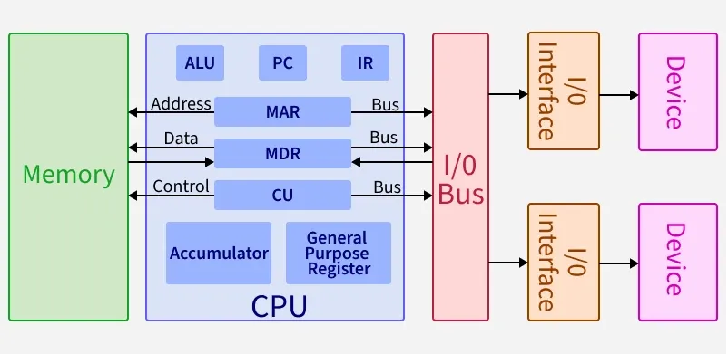</p>

- **CU (Control Unit)** - Gerencia como o processador funciona mandando sinais de controle (0/1) ao decodificar instruções.
- **ALU (Arithmetic and Logic Unit)** - Parte da CPU que lida com cálculos. Performa adição, subtração e operações lógicas, como comparações e deslocamento de bits em dados.

#### Registers

Tipo mais rápido de memória localizado na CPU.

- **PC (Program Counter)** - Endereço da próxima instrução a ser executada
- **IR (Instruction Register)** - Mantém a instrução atual sendo executada
- **MAR (Memory Address Register)** - Armazena o endereço da localização de memória sendo acessada
- **MDR (Memory Data Register)** - Armazena dados transferidos da/para a memória
- **Accumulator** - Armazena resultados intermediários de aritmética e operações lógicas
- **General Purpose Registers** - Uso para armazenamento temporário de dados

#### Bus

Sistema de comunicação que transfere dados, endereços, e sinais de controle entre a CPU, memória e dispositivos I/O. Na arquitetura de Von Neumann, um único bus é compartilhado para ambos dados e instruções.

### 1.2. Ciclo de instrução

Dois passos:
- Ciclo de busca (fetch)
- Ciclo de execução (execute)

#### Ciclo de busca

- PC tem endereço da próxima instrução
- Processador busca instrução na posição de memória armazenada no PC
   - MAR = PC
   - MBR = memória(MAR)
- PC = PC+4 (exceto em branch)
- Instrução armazenada no IR - IR = MBR

#### Ciclo de execução

- CU decodifica instrução e define sinais de controle
- Execução da instrução se resume a uma das seguintes possibilidades:
   - **Processador-memória**: Transferir dados do processador para a memória ou vice-versa
   - **Processador-I/O**: Transferir dados entre processador e dispositivo I/O
   - **Processamento de dados**: Executar operações aritméticas/lógicas sobre os dados
   - **Controle**: Especifica que a sequência de execução de instruções seja alterada
   - **Combinação dessas 4 possibilidades**

### 1.3. Arquitetura RISC-V

- Arquitetura de 32 bits
- 32 registradores de propósito geral
- 32 registradores para float

#### Compilando .asm

1. `sudo apt install nasm`
2. `sudo apt install binutils`
3. `nasm -f elf64 file.asm -o file.o` (monta arquivo)
4. `ld file.o -o file` (cria executável)

#### Estrutura de código

- `.data` - Início da seção de dados estáticos
- `.text` - Início da seção de código
- `.global label` - Entry point. Permite que outros arquivos chamem essa função durante o processo de link.

#### Diretivas

- `.align n` - Alinha a memória em $`2^{n}`$ bytes. Força o próximo dado/instrução a começar em um endereço de memória alinhado, utilizando padding.
   - `n = 0` para strings.
   - `n = 2` para instruções.
- `label: .asciz "str"` - Guarda string e encerra ela com `\0`
- `label: .byte b1,...,bn` - Reserva e inicializa cada byte sequencialmente.
- `label: .word w1,...,wn` - Reserva e inicializa cada word sequencialmente.
- `label: .double d1,...,dn` - Reserva e inicializa cada double sequencialmente.
- `label: .space n` - Reserva $`n`$ bytes

#### Registradores

- `ra` - Return address
- `sp` - Stack pointer
- `t0-t6` - Temporary
- `a0-a6` - Function arguments
- `a7` - Syscall register
- `s0-s11` - Saved values

#### Comandos

*Referência: [Risc-V Cheat Sheet](https://projectf.io/posts/riscv-cheat-sheet/)*

**Aritmética**
- `add rd, rs1, rs2` - `rd = rs1 + rs2` (2 registradores)
- `addi rd, rs1, imm` - `rd = rs1 + imm` (1 registrador, 1 valor imediato/constante)
- `sub rd, rs1, rs2` - `rd = rs1 - rs2`
- `mul rd, rs1, rs2` - `rd = rs1 * rs2`
- `div rd, rs1, rs2` - `rd = rs1 / rs2`
- `rem rd, rs1, rs2` - `rd = rs1 % rs2`
- `remu rd, rs1, rs2` - `rd = rs1 % rs2` (unsigned remainder)
- `xor rd, rs1, rs2` - `rd = rs1 xor rs2`

**Load/Store**
- `la rd, label` - `rd = label_addr`
- `lw rd, imm(rs1)` - `rd = mem[rs1+imm]` (word = 4 bytes)
- `lb rd, imm(rs1)` - `rd = mem[rs1+imm]` (byte)
- `sw rs2, imm(rs1)` - `mem[rs1+imm] = rs2`
- `sb rs2, imm(rs1)` - `mem[rs1+imm] = rs2`

**Jump/Function**
- `j label` - `pc += label` (Obs: Usa half-words para pular. `jmp 4` -> `pc += 4 * 2 bytes`)
- `jal rd, label` - `rd = pc+4; pc += label` (salva endereço de retorno)
- `jr ra` - `pc = ra`
- `call symbol` - `ra = pc+4; pc = &symbol`
- `ret` - `pc = ra`

**Branch (imm pode também ser um label)**
- `beq rs1, rs2, imm` - `if(rs1 == rs2) pc += imm`
- `bne rs1, rs2, imm` - `if(rs1 != rs2) pc += imm`
- `blt rs1, rs2, imm` - `if(rs1 < rs2) pc += imm`
- `ble rs1, rs2, imm` - `if(rs1 <= rs2) pc += imm`
- `bgt rs1, rs2, imm` - `if(rs1 > rs2) pc += imm`
- `bge rs1, rs2, imm` - `if(rs1 >= rs2) pc += imm`
- `bnez rs1, imm` - `if(rs1 != 0) pc += imm`

**Comparadores**
- `slt rd, rs1, rs2` - `rd = (rs1 < rs2)`
- `slti rd, rs1, imm` - `rd = (rs1 < imm)`

#### Ecalls

- `a7` - Armazena número da ecall
- `ecall` - Chama a ecall

<p align="center">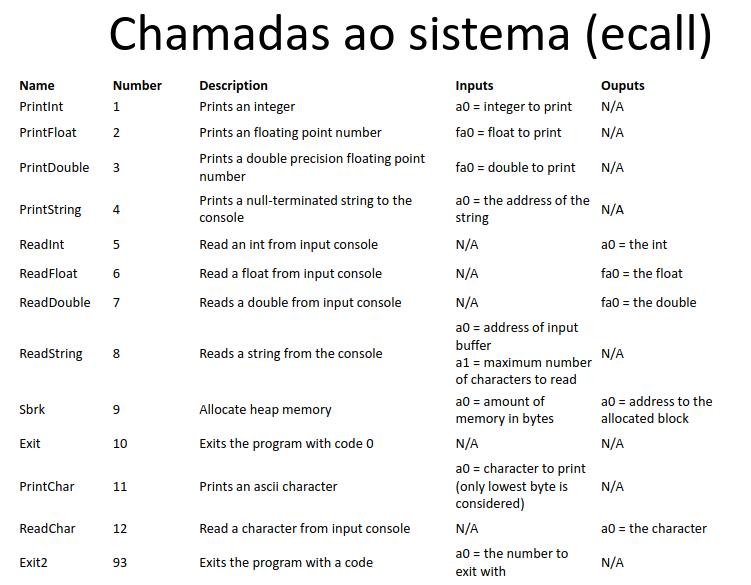</p>

#### Alocando na stack

**Empilhando**
- `addi sp, sp, -8` - Reserva 8 words
- `sw a0, 4(sp)` - Salva `a0` na stack (sp+4)
- `sw ra, 0(sp)` - Salva `ra` na stack (sp)

**Desempilhando**
- `lw a0, 4(sp)`
- `lw ra, 0(sp)`
- `addi sp, sp, 8`

#### Instruction Set Architecture

Modelo abstrato que define a interface programável da CPU do computador, definindo como o software interage com o hardware. Um dispositivo que interpreta as instruções descritas por uma ISA é uma implementação da ISA.

- Quantidade e função dos registradores
- Formato das instruções (6 tipos)

#### Formato das instruções (6 tipos)

<p align="center">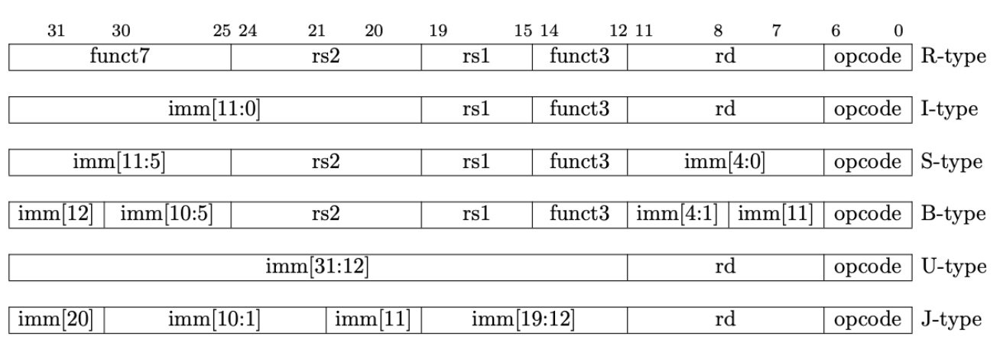</p>

##### Tipo R (register)

Operações matemáticas e lógicas: `add`, `sub`, `and`, `or`, `sll`
- `opcode` - Código da operação
- `rd` - Endereço do registrador destino
- `funct3` - Auxílio para definição da operação
- `rs1` - Endereço do primeiro registrador de origem
- `rs2` - Endereço do segundo registrador de origem
- `funct7` - Auxílio para definição da operação

Ex: `add rd1, rs1, rs2` -> `0000000 01000 01001 000 10010 0110011`

##### Tipo I (immediate)

Operações aritméticas com constantes ou instruções de leitura da memória: `addi`, `lw`, `andi`, `jalr`
- `opcode` - Código da operação
- `rd` - Endereço do registrador destino
- `funct3` - Auxílio para definição da operação
- `rs1` - Endereço do primeiro registrador de origem
- `imm` - Valor imediato

Ex: `lw s2, 0(sp)` -> `000000000000 00010 010 10010 0000011`

##### Tipo S (Store)

Escrever dados de um registrador para a memória: `sw`
- `opcode` - Código da operação
- `imm[4:0]` e `imm[11:5]` - Valor imediato (Separa os bits)
- `funct3` - Auxílio para definição da operação
- `rs1` - Endereço do primeiro registrador de origem
- `rs2` - Endereço do segundo registrador de origem

Ex: `sw s2, 0(sp)` -> `00000000 10010 00010 010 00000 0100011`

##### Tipo B (branch)

Desvios condicionais: `beq`, `bne`, etc
- `opcode` - Código da operação
- `imm[4:0]`, `imm[11]`, `imm[11:5]`, `imm[12]` - Valor imediato
- `funct3` - Auxílio para definição da operação
- `rs1` - Endereço do primeiro registrador de origem
- `rs2` - Endereço do segundo registrador de origem

Ex: `beq s1, s0, 4` -> `0 000000 01000 01001 000 0100 0 1100011`

##### Tipo U (Upper immediate)

Carregar números muito grandes diretamente nos bits superiores de um registrador: `lui`, `auipc`
- `opcode` - Código da operação
- `rd` - Endereço do registrador destino
- `imm[31:12]` - Valor imediato

Ex: `lui s0, 0x01234` -> `[0000 0001 0010 0011 0100] 01000 0110111`

##### Tipo J

Pulos incondicionais de longo alcance (chamadas de função e desvios obrigatórios): `jal`
- `opcode` - Código da operação
- `rd` - Endereço do registrador destino
- `imm[20]`, `imm[10:1]`, `imm[11]`, `imm[19:12]` - Valor imediato

Ex: `jal s0, -4` -> `1 1111111100 1 11111111 01000 1101111`

### 1.4. Monociclo (RISC-V)

A instrução é executada em um único ciclo de clock. Final de ciclo: tudo o que está nas conexões (linhas) é salvo nos registradores.

Componentes: PC, Banco registradores, ULA, UC, Memória, I/O.

Conjunto reduzido de instruções:
- Tipo R: `add`, `sub`, `and`, `or`
- Tipo I: `lw`
- Tipo S: `sw`
- Tipo B: `beq`

#### Metodologia de Clocking

Quaisquer valores armazenados em um elemento lógico sequencial são atualizados apenas em uma transição de clock: `State 1 -> Combinational Logic -> State 2`, em apenas 1 ciclo de clock.

#### Componentes

##### Arquitetura do banco de registradores

**READ**
1. 32 registradores
2. A saída de cada registrador vai para 2 MUX (saída duplicada)
3. 5 bits entram no Select do primeiro MUX -> Read Register 1 (5 bits)
4. 5 bits entram no Select do segundo MUX -> Read Register 2 (5 bits)
5. Saída do primeiro MUX -> Read Data 1 (32 bits)
6. Saída do segundo MUX -> Read Data 2 (32 bits)

**WRITE**
1. 32 registradores
2. Entrada Write Register (5 bits)
3. Entrada Write Data (32 bits)

<p align="center">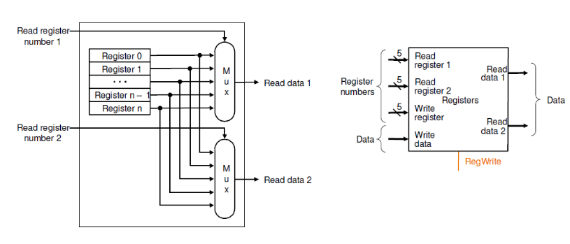</p>

##### Arquitetura da ALU

1. Recebe 2 entradas (32 bits)
2. Devolve saída (32 bits)

<p align="center">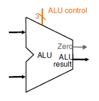</p>

##### Arquitetura de operações com memória

**Mem. Instrução:**
1. Recebe endereço do PC (32 bits)
2. Devolve instrução (32 bits)

<p align="center">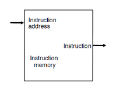</p>

**Mem. Dados:**
1. Recebe endereço da ULA (32 bits) -> Devolve Read Data (32 bits)
*ou*
1. Recebe endereço (32 bits) -> Escreve Write Data (32 bits)

<p align="center"></p>

#### Execução de instruções

##### Execução das instruções tipo R

- Leitura de dois registradores
- Realização de operação aritmética/lógica
- Escrita do resultado no registrador

<p align="center">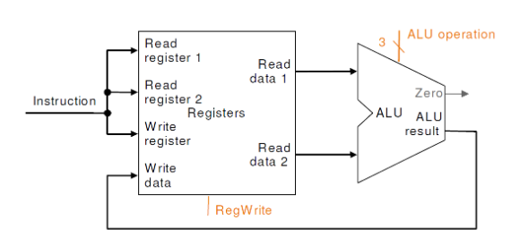</p>

##### Execução de load/store

- **Load**: Leitura de registrador origem e valor imediato
   - Calcula endereço usando deslocamento de 12 bits (usa ALU)
   - Lê a memória e atualiza o registrador destino.
- **Store**: Leitura de dois registradores origem e valor imediato
   - Calcula endereço usando deslocamento de 12 bits (usa ALU)
   - Escreve o valor do registrador na memória.

<p align="center">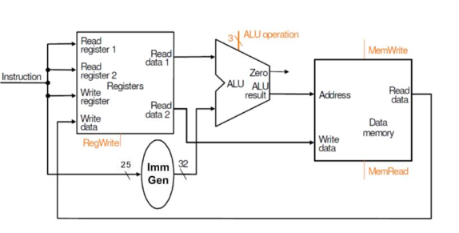</p>

##### Execução de Branch

- Leitura de registradores
- Comparação dos dois através da ALU (se forem iguais, `zero = 1`)
- Endereço destino = PC + offset

<p align="center">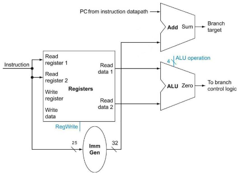</p>

#### Arquitetura completa

<p align="center">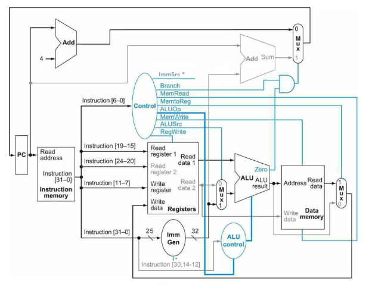</p>

#### Tabelas e Blocos Auxiliares

<p align="center">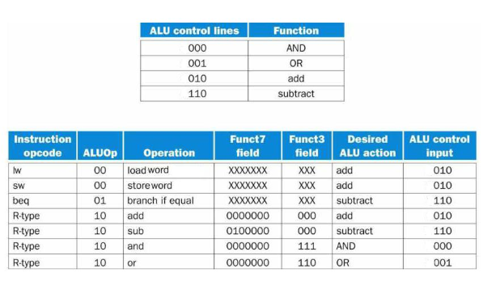</p>

<p align="center">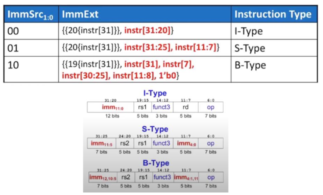</p>

<p align="center">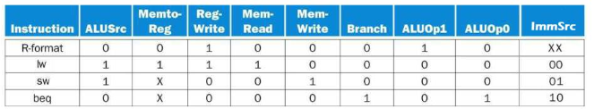</p>

### 1.5. Notas avulsas

#### -4 em binário (20 bits)

Ao invés de usar bit de sinal, podemos usar complemento de dois: Inverte e soma 1.

```text
00000000000000000100 -> 4
11111111111111111011 -> Complemento
+                  1
--------------------
11111111111111111100 -> -4
```

#### Formato de números inteiros

- 1 bit de sinal, 15 bits de magnitude.

## 2. Revisão de Lógica digital

### 2.1. Circuitos combinacionais e sequenciais

- Circuitos combinacionais - Função apenas de sinais de entrada.
- Circuitos sequenciais - Sinal de saída depende dos sinais anteriores de saída.

### 2.2. Identidades básicas

<p align="center">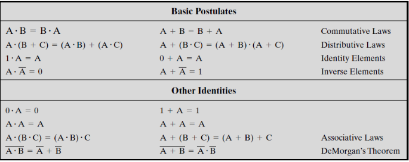</p>

### 2.3. Mapas de Karnaugh

Bits em ordem de Gray code (apenas 1 bit muda de estado a cada incremento/decremento).

Soma de produtos: Agrupar 1s em clusters de 1, 2, 4, 8, ...

<p align="center">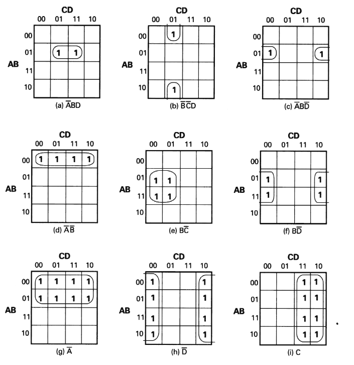</p>

== Principais circuitos

- Half Adder - 2 entradas, 1 saída, 1 Cout.
- Full Adder - 2 entradas, 1 Cin, 1 saída, 1 Cout.
- Demux - Entrada de $`n`$ bits, saída de $`2^{n}`$ bits. Somente uma saída é ativada para cada combinação de entradas.
- Mux - Até $`2^{n}`$ entradas e $`n`$ valores seletores. Direciona uma das entradas para a saída.

### 2.4. Flip Flops

São circuitos sequenciais.

#### Flip-Flop S-R

- Duas entradas: $`S`$ (set) e $`R`$ (reset)
- Duas saídas: $`Q`$ e $`\bar{Q}`$
- $`S = R = 1`$ deve ser evitada. Resolve-se com flip-flop de entrada única (Flip-Flop D).

#### Flip-Flop J-K

- $`J = K = 0`$ - Mantém
- $`J = 1 , K = 0`$ - Saída = 1
- $`J = 0 , K = 1`$ - Saída = 0
- $`J = K = 1`$ - Inverte

### 2.5. Registradores

Exemplo de uso de flip-flops.

- Registradores paralelos - Carregamento e descarregamento feito simultaneamente.
- Registradores de deslocamento - Transfere informações serialmente. Uso em I/O e também dentro da ALU (deslocamento lógico e rotação).
- Contadores - Registrador cujo valor é incrementado de 1 módulo a capacidade d

## 3. Segunda Parte

### 3.1. Multiciclo

A desvantagem do monociclo é que o uso do ciclo de clock se torna ineficiente, pois deve ser do tamanho da instrução mais lenta. Assim, instruções rápidas ficam aguardando tempo demais pelo fim do ciclo de clock.

No multiciclo, os ciclos de clock são menores, e cada ciclo de clock é ume estágio da instrução: IFech, Dec, Exec, Mem, WB. Nem todas as instruções demoram o mesmo número de ciclos de clock para finalizar.

<p align="center">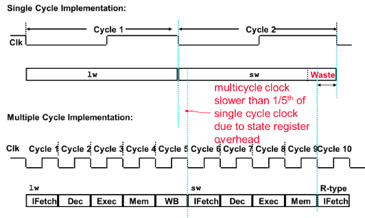</p>

### 3.2. Pipeline

Dividir a instrução em etapas, cada etapa vai ser executada em 1 ciclo de clock, com sobreposição de etapas diferentes, de instruções diferentes, no mesmo ciclo de clock. Ideia de linha de montagem.

#### Etapas

- IF: Instruction Fetch - Mem. Instr.
- ID: Instruction Decode - UC/Banco Reg.
- EX: Execution - ULA
- Mem: Memory Access - Mem. Dados
- WB: Write Back - Banco de Registradores

Lembre-se: IF, ID, EX, MEM, WB

<p align="center">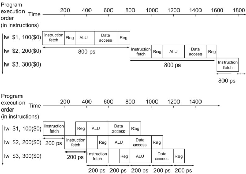</p>

#### Comparação entre Monociclo, Multiciclo e Pipeline

- Monociclo: Cada instrução é executada completa em um único ciclo de clock. O ciclo precisa ser longo o suficiente para aguentar a instrução mais lenta.
- Multiciclo: Divide a execução de uma instrução em várias etapas menores. O ciclo é curto e baseado na etapa mais longa. instruções diferentes usam um número diferente de ciclos. Uma nova instrução só começa quando a anterior termina.
- Pipeline: Divida a instrução em estágios, mas permite sobreposição.

Para 100 instruções:

Obs: IPC = instruction per clock, CPI = clock per instruction

- Monociclo:
   - Tempo de clock = 45 ns
   - Para 100 instruções: $`45 \cdot 100 = 4500`$ ns
- Multiciclo:
   - Tempo de clock = 10 ns
   - CPI médio = 4.2 clocks/inst.
   - Para 100 instruções: $`4.2 \cdot 10 \cdot 100 = 4200`$ ns
- Pipeline:
   - Tempo de ciclo de clock = 10 ns
   - N° de ciclos de clock = (1 inst: 5, 2 inst: 6, 3 inst: 7). Isso pois precisa primeiro "encher" o pipeline.
   - Para 100 instruções: 104 ciclos de clock - $`104 \cdot 10 = 1040`$ ns
   - Problema: paradas (gargalos - Instruções esperando liberar um componente, disputa por recursos)

o registrador.

#### Considerações

- O pipeline não diminui o tempo de execução de cada tarefa, mas reaproveita módulos não utilizados (aumenta throughput)
- A taxa do pipeline é limitada pelo estágio mais lento
- O pipeline trava se houver dependências

#### Registradores intermediários do pipeline

<p align="center">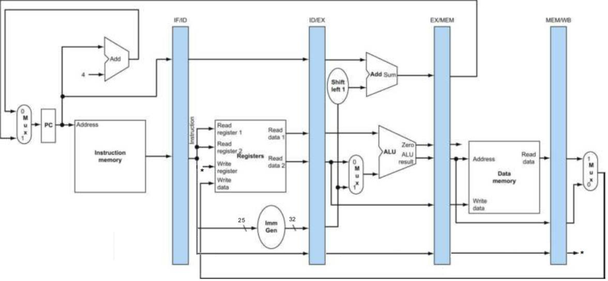</p>

<p align="center">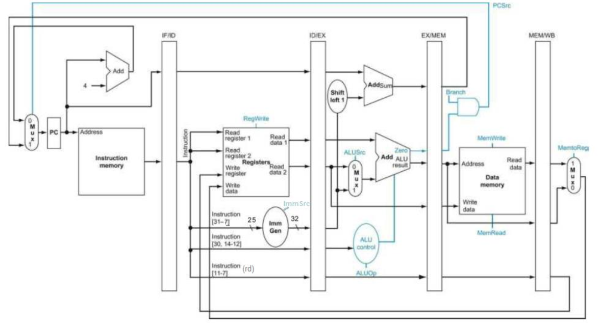</p>

Sinais de controle:

<p align="center">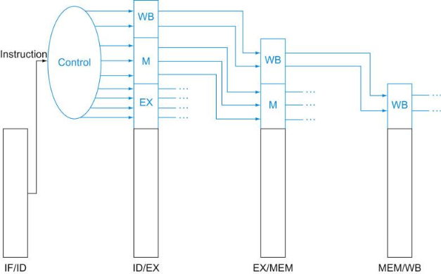</p>

#### Dependências ou conflitos

##### Conflitos estruturais

Acessos simultâneos à memória feitos por 2+ estágios.

- Acessos concorrentes à memória - Uso de memórias multi-portas ou com múltiplos bancos com acessos independentes
   - Soluções: Caches separadas de dados e instruções, memória com múltiplos de acesso independentes
- Leitura de instrução e leitura/escrita de dados simultâneos à memória - Uso de arquitetura "Harvard" com caches de dados e instrução separados
- Acesso simultâneo ao banco de registradores - Uso de banco de registradores com múltiplas portas
- Uso simultâneo de uma mesma unidade funcional - Replicação da unidade funcional ou implementação "pipelined" dessa unidade

##### Dependência de dados

Uma instrução faz uso de um operando que vai ser produzido por uma outra instrução que ainda está no pipeline. A execução da instrução seguinte depende do operando calculado pela instrução anterior.

Tipos de dependência de dados:

**Dependência verdadeira (diretas) ou RAW (Read After Write)** - Uma instrução utiliza um operando que é produzido por uma instrução anterior

```asm
add <R1>, R2, R3
sub R4, <R1>, R6
```

**Dependência falsa - Antidependência ou WAR (Write After Read)** - Uma instrução lê um operando que é escrito por uma instrução sucessora

```asm
sub R4, <R1>, R6
add <R1>, R2, R3
```

**Dependência de saída ou WAW (Write After Write)** - Uma instrução escreve em um operando que é também escrito por uma instrução sucessora

```asm
add <R4>, R2, R3
sub <R4>, R1, R6
```

###### Adiantamento de Dados (forwarding)

Caminho interno dentro do pipeline entre a saída e a entrada da ULA. Técnica conhecida como forwarding ou bypassing. Evita a parada do pipeline utilizando **buffers internos** em vez de esperar que o elemento de dado chegue nos registradores visíveis ao programador ou na memória.

<p align="center">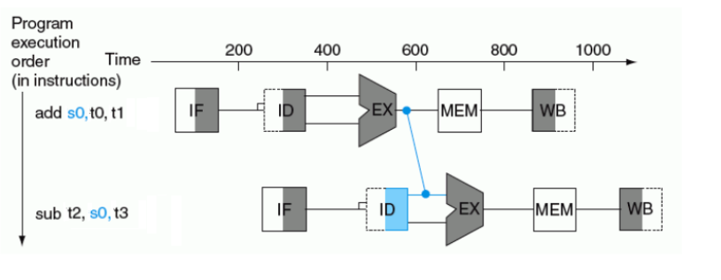</p>

Perceba que adiantamos a subtração de `s0` após ele ficar livre da primeira instrução.

Mas, em algumas situações, nem o forwarding pode resolver o problema de parada do pipeline

<p align="center">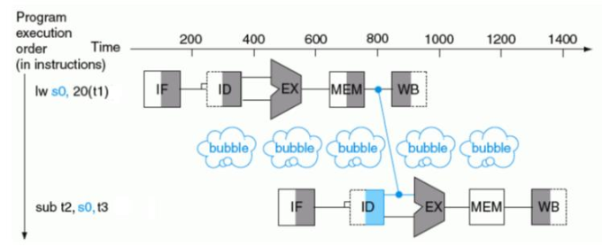</p>

Se as próximas instruções utilizam o valor do registrador, mas não escrevem nele, dá pra replicar ele para todas as próximas instruções. Observe sem forwarding:

<p align="center">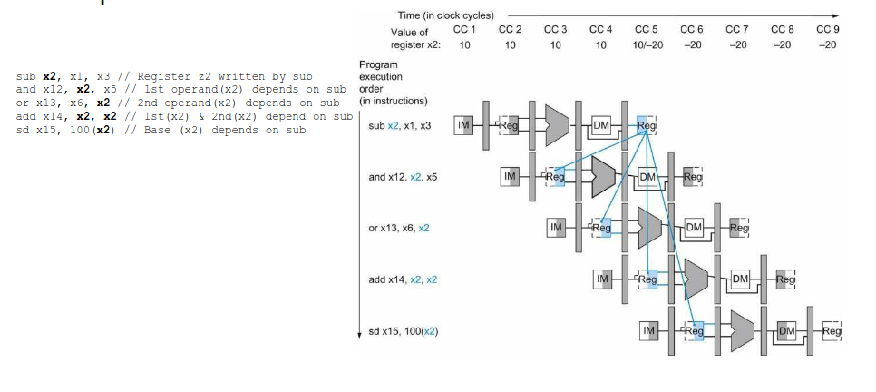</p>

E agora com forwarding:

<p align="center">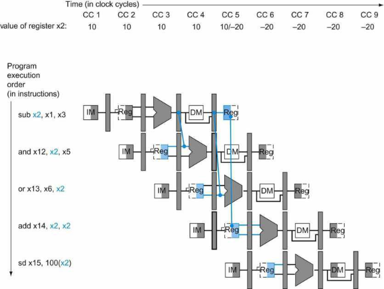</p>

Condições para que o adiantamento seja considerado:

- Destino da instrução que está entre os ciclos de **EX e MEM** é igual a um dos registradores de origem da instrução que está entre os ciclos de ID e EX
- Destino da instrução que está entre os ciclos de **MEM e WB** é igual a um dos registradores de origem da instrução que está entre os ciclos de ID e EX

<p align="center">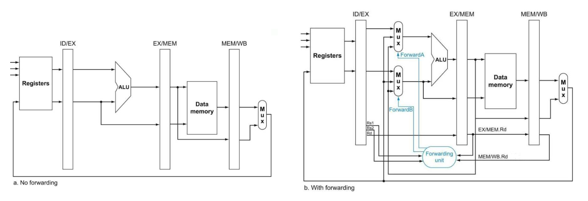</p>

<p align="center">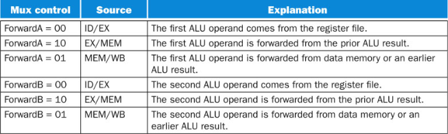</p>

Condições para detecção de dependência de dados:

- Dependência EX:

```asm
if (EX/MEM.RegWrite and (EX/MEM.Rd != 0) and (EX/MEM.RegWrite = ID/EX.Rs1)) ForwardA = 10

if (EX/MEM.RegWrite and (EX/MEM.Rd != 0) and (EX/MEM.Rd = ID/EX.Rs2)) ForwardB = 10
```

- Dependência MEM:

```asm
if(MEM/WB.RegWrite and (MEM/WB.Rd != 0) and (MEM/WB.Rd = ID/EX.Rs1)) ForwardA = 01

if(MEM/WB.RegWrite and (MEM/WB.Rd != 0) and (MEM/WB.Rd = ID/EX.Rs2)) ForwardA = 01
```

Problema: Quando se está acumulando os valores de um vetor em um registrador e lê e escreve no mesmo registrador.

```asm
add 1,1,2
add 1,1,3
add 1,1,4
...
```

Agora mudamos para a dependência MEM.

```asm
if(MEM/WB.RegWrite and (MEM/WB.Rd != 0) and(EX/MEM.rd != ID/EX.rs1) and (MEM/WB.Rd = ID/EX.Rs1)) ForwardA = 01

if(MEM/WB.RegWrite and (MEM/WB.Rd != 0) and (EX/MEM.rd != ID/EX.rs2) and (MEM/WB.Rd = ID/EX.Rs2)) ForwardA = 01
```

# Matemática Discreta (SMA0180)

## 1. Contagem

> [!NOTE]
> **Conceitos importantes**
>
> - *Disjunto* - Dois conjuntos são disjuntos se não possuem elemento em comum.
> - *Mutuamente disjuntos* - Um conjunto de conjuntos é uma família de conjuntos mutuamente disjuntos se todos os pares possíveis $`S_{i}`$ são disjuntos.
> - *Tamanho de um conjunto* - Número de elementos distintos em $`S`$

> [!NOTE]
> **Princípio da soma**
>
> O tamanho de uma união de conjuntos finitos **mutuamente disjuntos** é a soma do tamanho dos conjuntos.
>
> ```math
> | \cup_{i = 1}^{m} S_{i} | = \sum_{i = 1}^{m} | S_{i} |
> ```
>
> > **Exemplo.**
> >
> > ```
> > i = 1, ..., r
> >   j = 1, ..., m
> >     k = 1, ..., n
> > ```
> >
> > ```math
> > | S_{i , j} | = n
> > ```
> >
> > ```math
> > | T_{i} | = | \cup_{j = 1}^{m} S (i , j) | = \sum_{j = 1}^{m} S (i , j) = \sum_{j = 1}^{m} n = m \cdot n
> > ```
> >
> > ```math
> > \text{Total} = | \cup_{i = 1}^{r} T_{i} | = \sum_{i = 1}^{r} T_{i} = \sum_{i = 1}^{r} m \cdot n = m \cdot n \cdot r
> > ```

> [!NOTE]
> **Princípio do produto**
>
> O tamanho de uma união de m conjuntos disjuntos de tamanho n é igual a $`m \cdot n`$.
>
> Ou então, se temos *n maneiras de realizar A* e *m maneiras de realizar B*, então temos $`n \cdot m`$ maneiras de realizar A e B.

## 2. Contagem de listas, permutações e subconjuntos

> [!IMPORTANT]
> **Uso do princípio da soma e do produto**
>
> Uma senha pode conter 4,5,6,7 ou 8 caracteres. Quantas senhas no total?
>
> ```math
> P = P_{4} \cup P_{5} \cup P_{6} \cup P_{7} \cup P_{8}
> ```
>
> Como $`P_{i}`$ são mutuamente disjuntos, pode-se aplicar o princípio da soma:
>
> ```math
> | P | = \sum_{i = 4}^{8} | P_{i} |
> ```
>
> Para cada letra, há 52 escolhas. Assim, pelo princípio do produto:
>
> ```math
> | P | = 52^{4} + 52^{5} + 52^{6} + 52^{7} + 52^{8}
> ```

> [!NOTE]
> **Princípio da bijeção**
>
> Dois conjuntos possuem o mesmo tamanho se, e somente se, há uma função um-para-um de um conjunto em outro.

> [!IMPORTANT]
> **Permutação de k-elementos de um conjunto**
>
> Quantas permutações de $`\{1 , 2 , \ldots , n\}`$ podemos fazer? Ex: Escolher $`k = 3`$ pessoas diferentes de um grupo de $`n`$ pessoas.
>
> Lógica: $`n \cdot (n - 1) \cdot (n - 2) \ldots`$
>
> ```math
> n \frac{!}{n - k} !
> ```

> [!IMPORTANT]
> **Contando subconjuntos de um conjunto**
>
> Quantos subconjuntos **únicos** de $`k`$ elementos pode-se fazer em um conjunto de tamanho $`n`$? A ordem não importa, ou seja, $`\{1 , 2\} = \{2 , 1\}`$. Deve-se remover as permutações.
> Usa-se coeficiente binomial para "escolher $`k`$ dentre $`n`$":
>
> ```math
> \binom{n}{k} = n \frac{!}{(n - k) ! k !}
> ```
>
> > **Exemplo.**
> >
> > Contar caminhos em 10 passos. Direções possíveis: $`\{D , D , D , D , D , D , C , C , C , C\}`$
> >
> > ```math
> > \text{\_ \_ \_ \_ \_ \_ \_ \_ \_ \_}
> > ```
> >
> > - $`\binom{10}{4}`$: Escolher 4 posições de 10 para C. Elimina repetições (CDC = CDC)
> >
> > - Ou $`\binom{10}{6}`$: Escolher 6 posições de 10 para D.

## 3. Coeficientes binomiais

> [!NOTE]
> **Relação de Pascal**
>
> ```math
> \binom{n}{k} = \binom{n - 1}{k - 1} + \binom{n - 1}{k}
> ```

> [!NOTE]
> **Teorema binomial**
>
> ```math
> (x + y)^{n} = \sum_{i = 0}^{n} \binom{n}{i} x^{n - i} y^{i}
> ```
>
> > **Prova.**
> >
> > ```math
> > \begin{gathered} (x + y)^{3} = \\ = (x x + x y + y x + y y) (x + y) = (x x + x y + y x + y y) x + (x x + x y + y x + y y) y = \\ = x x x + x y x + y x x + y x x + x x y + x y y + y x y + y y y \end{gathered}
> > ```
> >
> > - Coeficiente de $`x x x = \binom{3}{0}`$ (escolher 0 posições para y)
> > - Coeficiente de $`x x y = \binom{3}{1}`$ (escolher 1 posição para y)
> > - Coeficiente de $`x y y = \binom{3}{2}`$ (escolher 2 posições para y)
> > - Coeficiente de $`y y y = \binom{3}{3}`$ (escolher 3 posições para y)

## 4. Relações de equivalência e contagem

> [!NOTE]
> **Relação entre conjuntos**
>
> Uma relação entre 2 conjuntos X, Y é um conjunto de pares ordenados:
>
> ```math
> R = \{(x , y) | x \in X , y \in Y \text{ satisfazem ...}\}
> ```
>
> Quando $`(x , y) \in R`$, escrevemos $`x \sim y`$.
>
> Propriedades:
>
> 1. Reflexiva - $`x \sim x`$
> 1. Simétrica - $`x \sim y \Leftrightarrow y \sim x`$
> 1. Transitiva - $`x \sim y , y \sim z \Rightarrow x \sim z`$
>
> Uma relação é de equivalência se é reflexiva, simétrica e transitiva.
>
> Dada uma relação de equivalência, as classes de equivalência são os conjuntos formados por elementos **relacionados** ($`x = 1 \rightarrow \{y_{1} , y_{2} , \ldots\}`$). De modo geral:
>
> ```math
> [x] = \{y | y \sim x\}
> ```
>
> As classes de equivalência codificam simetrias/invariâncias.

## 5. Aritmética modular

> [!NOTE]
> **Conjunto modular**
>
> $`\mathbb{Z}_{n}`$ = Inteiros módulo n. Possui as operações de adição e multiplicação.

> [!NOTE]
> **Propriedades da adição modular**
>
> 1.
>
>    ```math
>    a \bmod n = (a + k \cdot n) \bmod n
>    ```
>
> 1.
>
>    ```math
>    (a + b) \bmod n = a \bmod n + b \bmod n
>    ```
>
> Adicionar/subtrair dos dois lados sempre conserva a igualdade.

> [!NOTE]
> **Propriedades da multiplicação modular**
>
> 1.
>
>    ```math
>    (a \cdot b) \bmod n = (a \bmod n \cdot b \bmod n) \bmod n
>    ```
>
> 1.
>
>    ```math
>    a = b \text{ } (\bmod n) \Rightarrow a c = b c \text{ } (\bmod n)
>    ```
>
> 1.
>
>    ```math
>    a = b \text{ } (\bmod n) \Rightarrow \frac{a}{c} = \frac{b}{c} \text{ } (\bmod n) \Leftrightarrow m d c (c , n) = 1
>    ```
>
> Multiplicar dos dois lados sempre conserva a igualdade.
>
> Dividir dos dois lados só conserva a igualdade se o divisor for coprimo com $`n`$ (sem fatores em comum).

> [!NOTE]
> **Coprimo**
>
> Um número $`a`$ é coprimo com $`n`$ se $`m d c (a , n) = 1`$. Isso também pode ser visto como a existência de inverso multiplicativo.

> [!NOTE]
> **Inverso multiplicativo e Algoritmo estendido de Euclides**
>
> Dado $`a \in \mathbb{Z}_{n}`$, o inverso multiplicativo na operação de módulo é caracterizado por:
>
> ```math
> a a^{- 1} = 1 \bmod n
> ```
>
> Essa equação só tem solução se $`m d c (a , n) = 1`$ (Teorema de Bezault é válido para 1).
>
> > **Algoritmo de Euclides.**
> >
> > Dado $`a > b`$:
> >
> > ```math
> > m d c (a , b)
> > ```
> >
> > ```math
> > a = k \cdot b + r
> > ```
> >
> > ```math
> > m d c (a , b) = m d c (r , b)
> > ```
> >
> > E assim por diante, até
> >
> > ```math
> > m d c (x , 1)
> > ```
> >
> > .
> >
> > Resumo: Pega maior e substitui pelo módulo com o menor.
>
> > **Teorema de Bezault.**
> >
> > Dados $`a , n \in \mathbb{Z}`$,  $`\exists \alpha , \beta \in \mathbb{Z}`$ tal que:
> >
> > ```math
> > m d c (a , n) = \alpha a + \beta n
> > ```
>
> > **Algoritmo estendido de Euclides.**
> >
> > Dado o teorema de Bezault, o algoritmo estendido de Euclides consiste em encontrar $`\alpha , \beta`$ tal que:
> >
> > ```math
> > \alpha \cdot a + \beta \cdot b = m d c (a , b)
> > ```
> >
> > Através do seguinte algoritmo:
> >
> > 1. Calcular $`m d c`$ através do algoritmo de Euclides, guardando todas as expressões do tipo $`a = k \cdot b + r`$
> > 1. Ao chegar em $`r = m d c (a , b)`$, deve-se colocar $`m d c (a , b)`$ em função de $`a , b`$, substituindo todos os restos, da última para a primeira expressão.
> >
> > > **Exemplo.**
> > >
> > > Dado $`m d c (1097 , 520) = 1`$, queremos encontrar $`\alpha , \beta`$ tal que $`\alpha \cdot 1097 + \beta \cdot 520 = 1`$.
> > >
> > > Primeiro, o algoritmo de Euclides.
> > >
> > > ```math
> > > m d c (1097 , 520) = m d c (57 , 520) = m d c (57 , 7) = m d c (1 , 7)
> > > ```
> > >
> > > ```math
> > > \begin{cases} 107 = 2 \cdot 520 + 57 \\ 520 = 9 \cdot 57 + 7 \\ 57 = 8 \cdot 7 + 1 \end{cases}
> > > ```
> > >
> > > Depois, isolamos os restos:
> > >
> > > ```math
> > > \begin{cases} 57 = 107 - 2 \cdot 520 \\ 7 = 520 - 9 \cdot 57 \\ 1 = 57 - 8 \cdot 7 \end{cases}
> > > ```
> > >
> > > E substituímos, do último para o primeiro:
> > >
> > > ```math
> > > 1 = 57 - 8 \cdot 7
> > > ```
> > >
> > > ```math
> > > 1 = 57 - 8 \cdot (520 - 9 \cdot 57)
> > > ```
> > >
> > > ```math
> > > 1 = - 8 \cdot 520 + 73 \cdot 57
> > > ```
> > >
> > > ```math
> > > 1 = - 8 \cdot 520 + 73 (1097 - 2 \cdot 520)
> > > ```
> > >
> > > ```math
> > > 1 = - 154 \cdot 520 + 73 \cdot 1097
> > > ```
> > >
> > > Assim:
> > >
> > > ```math
> > > \therefore \alpha = 73 , \beta = - 154
> > > ```
>
> Exemplo de cálculo de inverso multiplicativo.
>
> > **Exemplo.**
> >
> > Para $`a = 520 , n = 1097`$:
> >
> > ```math
> > m d c (520 , 1097) = 1
> > ```
> >
> > Aplicando Euclides estendido:
> >
> > ```math
> > - 154 \cdot 520 + 73 \cdot 1097 = 1
> > ```
> >
> > Aplicando $`\bmod 1097`$:
> >
> > ```math
> > - 154 \cdot 520 \bmod 1097 = 1 \bmod 1097
> > ```
> >
> > A solução precisa estar em $`\mathbb{Z}_{1096}`$, ou seja, $`a^{- 1} \in \{0 , 1096\}`$. Para isso, basta somar o módulo, que encontra-se um resultado equivalente:
> >
> > ```math
> > (- 154 + 1097) \cdot 520 \bmod 1097 = - 154 \cdot 520 \bmod 1097 + 1097 \cdot 520 \bmod 1097 = 1 \bmod 1097
> > ```
> >
> > Portanto:
> >
> > ```math
> > \therefore a^{- 1} = - 154 + 1097 = 943
> > ```
>
> Obs: Se o resultado for negativo, basta aplicar:
>
> ```math
> a^{- 1} \equiv a^{- 1} + n
> ```
>
> Para encontrar um resultado equivalente dentro de $`\mathbb{Z}_{n}`$.

> [!NOTE]
> **Teorema de Euler**
>
> Seja $`m = \phi (n)`$. O conjunto dos **coprimos** (não todos os elementos, mas apenas os que possuem inverso multiplicativo!) de $`n`$ é:
>
> ```math
> \{x_{1} , \ldots , x_{m}\}
> ```
>
> Multiplicamos por $`a`$ com $`m d c (a , n) = 1`$. Isso garante a inexistência de fatores em comum, e o novo conjunto contém os mesmos números do conjunto original, mas em uma ordem diferente. Nenhum se repete.
>
> ```math
> \{a x_{1} , \ldots , a x_{m}\}
> ```
>
> Como os conjuntos contém os mesmos elementos, o produto de todos os elementos de cada conjunto é equivalente.
>
> ```math
> (x_{1} \cdot \ldots \cdot x_{m}) = a^{m} \cdot (x_{1} \cdot \ldots \cdot x_{m}) \bmod n
> ```
>
> Como o produto ($`x_{1} \cdot \ldots \cdot x_{m}`$) é coprimo com $`n`$, podemos cancelá-lo dos dois lados da igualdade (**coprimo = $`m d c (a , n) = 1`$, logo para cada $`x_{i}`$ existe um inverso multiplicativo**). O que sobra é o teorema de Euler.
>
> ```math
> (x_{1} \cdot \ldots \cdot x_{m}) (x_{1}^{- 1} \cdot \ldots \cdot x_{m}^{- 1}) = a^{m} \cdot (x_{1} \cdot \ldots \cdot x_{m}) (x_{1}^{- 1} \cdot \ldots \cdot x_{m}^{- 1}) \bmod n
> ```
>
> ```math
> \therefore 1 = a^{\phi} (n) \bmod n
> ```
>
> Isso significa que **as potências de um tamanho qualquer $`a \in \mathbb{N}^{\ast}`$ em módulo $`n`$ posusi tamanho de ciclo que divide ou é igual a $`\phi (n)`$**. A cada $`\phi \frac{n}{n}`$ multiplicações, o resultado volta para 1.
>
> Para encontrar o tamanho do ciclo, basta **encontrar o menor expoente positivo $`k`$ que resulta em 1** para $`a^{k} \bmod 7`$ (ao chegar em 1, é confirmado o reset do ciclo). Se $`k = 2`$, os ciclos possuem tamanho 2.

> [!NOTE]
> **Função totiente**
>
> Para $`n`$ fatorado em primos de modo que $`n = p_{1}^{a_{1}} \cdot p_{2}^{a_{2}} \ldots`$, a função totiente é definida como:
>
> ```math
> \phi (n) = n \cdot \left( 1 - \frac{1}{p_{1}} \right) \cdot \left( 1 - \frac{1}{p_{2}} \right) \ldots
> ```
>
> E fornece a quantidade de números menores ou igual a $`n`$ co-primos com respeito a ele (Ex: $`\phi (8) = 4`$, pois 1,3,5,7 são co-primos). Isso fornece o **tamanho exato do conjunto de elementos que possuem inverso multiplicativo módulo n** ($`a`$ tal que $`m d c (a , n) = 1`$), ou coprimos.
>
> 1) Em particular: dado $`n = p \cdot q`$, com $`p , q`$ primos, a função totiente é calculada como:
>
> ```math
> \phi (n) = (p - 1) (q - 1)
> ```
>
> 2) Em particular: dado $`n`$ primo, $`\phi (n) = n - 1`$.

> [!NOTE]
> **Pequeno teorema de Fermat**
>
> Caso particular do teorema de Euler para $`p`$ primo:
>
> ```math
> a^{p - 1} = 1 \bmod p
> ```
>
> Em particular, se $`a \in \mathbb{Z}_{p}`$ então:
>
> ```math
> a^{1} \cdot a^{p - 2} = 1 \bmod p
> ```
>
> ```math
> \therefore a^{- 1} = a^{p - 2} \bmod p
> ```
>
> Na prática, isso permite simplificar potências gigantescas:
>
> ```math
> a^{k} = a^{k \bmod \phi (n)} \bmod p
> ```
>
> > **Exemplo.**
> >
> > ```math
> > 7^{1020} \bmod 103
> > ```
> >
> > ```math
> > \phi (103) = 102
> > ```
> >
> > ```math
> > 1020 = 10 \cdot (102) + 0
> > ```
> >
> > ```math
> > 7^{1020 \bmod 102} \cdot 7^{0} \bmod 103 = 7^{10 \cdot 102 \bmod 102} \cdot 7^{0} \bmod 103 = 1 \bmod 103
> > ```

> [!NOTE]
> **Propriedades da potenciação modular**
>
> Definimos:
>
> ```math
> a^{k} \bmod n
> ```
>
> Propriedades:
>
> - $`a^{k_{1} + k_{2}} \bmod n = a^{k_{1}} \cdot a^{k_{2}} \bmod n`$
> - Pequeno teorema de Fermat: $`a^{\phi} (n) \bmod n = 1 \bmod n`$
> - Pequeno teorema de Fermat: para $`a , n`$ coprimos, $`a^{- 1} = a^{n - 2} \bmod n`$
> - O tamanho de ciclo é um divisor de $`\phi (n)`$.
>
> **Propriedade de ciclo para $`a , n`$ coprimos**:
>
> Para encontrar o tamanho de ciclo $`K`$, basta encontrar $`K`$ tal que:
>
> ```math
> a^{K} = 1 \bmod n_{1}
> ```
>
> **Propriedade de ciclo para $`a , n`$ não coprimos**:
>
> A parte coprima $`n_{1}`$ é a multiplicação de todos os fatores de $`n`$ que não compartilham primos com $`a`$.
>
> A parte não coprima $`n_{2}`$ é a multiplicação de todos os fatores de $`n`$ que compartilham primos com $`a`$. Eles são tais que:
>
> ```math
> n = n_{1} \cdot n_{2}
> ```
>
> ```math
> m d c (n_{1} , n_{2}) = 1
> ```
>
> A parte coprima $`n_{1}`$ define o tamanho de ciclo $`K`$. Basta encontrar $`K`$ tal que:
>
> ```math
> a^{K} = 1 \bmod n_{1}
> ```
>
> A parte não coprima $`n_{2}`$ define um pré-período de modo que ele termina em $`k = K - 1`$. Bata encontrar $`K`$ tal que:
>
> ```math
> a^{K} = 0 \bmod n_{2}
> ```
>
> > **Exemplo.**
> >
> > ```math
> > 4^{k} \bmod 20
> > ```
> >
> > 1. $`10 = 2^{2} \cdot 5`$
> > 1. $`4 = 2^{2}`$
> > 1. $`n_{1} = 5`$
> > 1. $`n_{2} = 2^{2}`$
> >
> > Verificando:
> >
> > - $`20 = 5 \cdot 2^{2}`$
> > - $`m d c (5 , 4) = 1`$
> >
> > Encontrando tamanho do ciclo:
> >
> > $`4^{k} \bmod 5 = 4 , [1] , \ldots`$
> >
> > O tamanho do ciclo é 2.
> >
> > Encontrando pré-período:
> >
> > $`4^{k} \bmod 4 = [0]`$
> >
> > O ciclo começa em $`k = 1`$. Ou seja, sem pré-período.
> >
> > Resumo:
> >
> > - Ciclo de tamanho 2
> > - Sem pré-período
> >
> > Potenciação completa:
> >
> > ```math
> > 4^{k} \bmod 20 = 4 , 16 , 4 , 16 , 4 , 16 , \ldots
> > ```

> [!NOTE]
> **Achar solução de sistema de equações modulares**
>
> ```math
> \begin{cases} x \bmod 5 = 4 \\ x \bmod 7 = 5 \end{cases}
> ```
>
> 1. Escolha uma equação e coloque na forma completa: $`x = 5 k + 4`$
> 1. Substitua no valor de $`x`$ na segunda equação
> 1. Ache o inverso modular do número que multiplica $`k`$ e multiplique dos dois lados para obter $`k`$
> 1. Ao substituir $`k`$ na equação inicial, temos $`x`$.
>
> Obs: Na equação $`5 k = 2 (\bmod 7)`$, basta encontrar $`5^{- 1} \bmod n`$ e multiplicar dos dois lados. (isso que é "dividir" dos dois lados em aritmética modular).
>
> Obs: Se a constante que multiplica $`k`$ não tiver inverso multiplicativo, o sistema não possui solução.

> [!NOTE]
> **Teorema Chinês do Resto**
>
> Dado um sistema de equações do tipo:
>
> ```math
> \begin{cases} x \bmod m_{1} = a_{1} \\ x \bmod m_{2} = a_{2} \\ \ldots \\ x \bmod m_{k} = a_{k} \end{cases}
> ```
>
> Se os módulos $`m_{1} , m_{2} , \ldots . , m_{k}`$ forem primos entre si dois a dois (mdc = 1), o teorema garante que:
>
> 1. O sistema sempre possui uma **solução única** dentro de um período (x = A + kB).
> 1. A solução geral é dada módulo $`M = m_{1} \cdot m_{2} \ldots m_{k}`$ (produto dos módulos).
>
> Caso os módulos não sejam primos entre si, ainda assim podem ter solução. As congruências precisam ser analisadas dois a dois, de modo que:
>
> ```math
> (a_{1} - a_{2}) = k \cdot m d c (m_{1} , m_{2}) , k \in \mathbb{Z}
> ```
>
> Se a condição for verdadeira, o sistema possui solução, e ela é única módulo o $`m m c`$ entre os módulos.
>
> Se a condição for falsa, o sistema não possui solução inteira.

> [!NOTE]
> **Teorema de Wilson**
>
> O teorema de Wilson afirma que:
>
> ```math
> (p - 1) ! \bmod p = (p - 1)
> ```
>
> Isso pois $`(p - 1) !`$ é a multiplicação de todos os coprimos de $`p`$. Como todos são coprimos, todos possuem inverso multiplicativo.
>
> Assim, aos pares, a multiplicação entre os coprimos resulta em $`1`$. O inverso multiplicativo de $`(p - 1)`$ é ele mesmo, de modo que ele é o termo que sobra.
>
> Sempre serão formados pares formando apenas $`(p - 1)`$, pois todos os primos são ímpares, exceto $`2`$.
>
> ```math
> 1 \cdot 2 \cdot 3 \cdot 4 \cdot 5 \cdot 6 \bmod 7
> ```
>
> - $`1^{- 1} = 1`$
> - $`2^{- 1} = 4`$
> - $`3^{- 1} = 5`$
> - $`6^{- 1} = 6`$
>
> Portanto:
>
> ```math
> [1] \cdot [2 \cdot 4] \cdot [3 \cdot 5] \cdot 6 \bmod 7 = 1 \cdot 6 \bmod 7
> ```

### 5.1. Anotações

> [!IMPORTANT]
> **Achar x de equação linear**
>
> Para calcular equações do tipo:
>
> ```math
> a \cdot_{n} x = b
> ```
>
> Precisamos do inverso multiplicativo, de modo que:
>
> ```math
> x = b \cdot_{n} a^{- 1}
> ```
>
> Lembrando que o inverso multiplicativo só existirá se $`m d c (a , n) = 1`$, e é calculado por Euclides estendido.

> [!IMPORTANT]
> **multiplicando pelo inverso dos dois lados**
>
> Se p é primo e $`a < p`$, $`a`$ sempre tem inverso multiplicativo:
>
> ```math
> a x =_{p} 1 \Leftrightarrow x =_{p} a^{- 1}
> ```
>
> Isso pois $`m d c (p , a) = 1`$ sempre (condição de existência de inverso multiplicativo).

> [!IMPORTANT]
> **Observações sobre multiplicação com a,n primos entre si**
>
> Para equação linear, com $`a , n`$ primos entre si:
>
> ```math
> k \cdot a \bmod n
> ```
>
> Como $`n`$ é primo, $`\phi (n) = n - 1`$. Essa é quantidade de elementos em um ciclo.
>
> Na aritmética modular, quando você multiplica uma **sequência completa de restos** (k) por um **número que não compartilha fatores com o módulo** (a), o conjunto resultado não possui repetições, formando uma permutação perfeita. Essa demonstração é feita no teorema de Euler.
>
> Para ilustrar, tome $`n = 11`$. Como $`\phi (n) = 10`$, $`k \in \{0 , 1 , 2 , 3 , 4 , 5 , 6 , 7 , 8 , 9 , 10\}`$ (todos os restos possíveis). Tome $`a = 5`$. Pela mesma demonstração do teorema de Euler, **multiplicar o conjunto dos restos de $`\bmod n`$ por uma constante qualquer mantém os mesmos restos, mas permutando sua ordem no conjunto** (por causa da existência de inverso multiplicativo). Sem repetição.
>
> Obs: $`k , n`$ e $`a , n`$ devem ser primos entre si para isso ser válido (atesta existência de inverso multiplicativo).

> [!IMPORTANT]
> **Observações sobre multiplicação com a,n possuindo fatores em comum**
>
> Para equação linear, com $`a , n`$ não primos entre si:
>
> ```math
> k \cdot a \bmod n
> ```
>
> Definindo $`d = m d c (a , n)`$:
>
> - Apenas múltiplos de $`d`$ aparecerão na sequência do ciclo.
> - O conjunto terá apenas $`\frac{n}{d}`$ números diferentes.
> - Cada um desses valores únicos se repetirá $`d`$ vezes ao longo do intervalo de $`[0 , n - 1]`$
>
> > **Exemplo.**
> >
> > ```math
> > k \cdot 4 \bmod 6
> > ```
> >
> > Para $`k \in [0 , 5]`$:
> >
> > - Sequência: $`\{0 , 4 , 2 , 0 , 4 , 2 )\}`$
> > - Valores únicos: $`\frac{6}{2} = 3`$
> > - Repetição: $`d = 2`$ vezes

## 6. Outros

> [!NOTE]
> **Algoritmo de Exponenciação Binária**
>
> Para calcular: $`2^{m} = 2^{312}`$, ao invés de calcular 312 multiplicações, dividimos o expoente em potências de 2:
>
> $`2^{312} = 2^{256} \cdot 2^{32} \cdot 2^{16} \cdot 2^{8}`$
>
> 1. $`2^{8} = ((2^{2})^{2})^{2}`$ - 3 mult.
> 1. $`2^{16} = (2^{8})^{2}`$ - 1 mult.
> 1. $`2^{32} = (2^{16})^{2}`$ - 1 mult.
> 1. $`2^{256} = ((((2^{32})^{2})^{2})^{2})`$ = 3 mult.
> 1. Multiplica tudo.
>
> Total de multiplicações: 8 + 4 (n° multiplicações)
>
> No geral: Total de multiplicações = $`\lceil \log_{2} (m) \rceil + (\text{n° de bits 1 em m}) - 2`$
>
> Em geral, para um expoente $`m`$, $`O (n) = \log_{2} (m)`$

## 7. RSA

> [!NOTE]
> **RSA**
>
> Dado $`n = p \cdot q`$ (público), com $`p , q`$ primos, $`e \in \mathbb{N}`$ (púiblic) e uma mensagem $`M < n`$, a mensagem criptografada $`y`$ é:
>
> ```math
> y = M^{e} \bmod n
> ```
>
> A chave necessária para descriptografar é:
>
> ```math
> d = e^{- 1} \bmod (p - 1) (q - 1)
> ```
>
> Onde $`e^{- 1}`$ é o inverso multiplicativo de $`e \bmod n`$, De modo que:
>
> ```math
> y^{d} = y^{e e^{- 1} \bmod (p - 1) (q - 1)} = M
> ```
>
> A segurança no RSA consiste na dificuldade do cálculo dos primos $`p , q`$.

> [!IMPORTANT]
> **Por que a descriptografia do RSA funciona**
>
> Por definição:
>
> ```math
> e d = 1 \bmod \phi (n)
> ```
>
> Que pode ser reescrito como:
>
> ```math
> e d = 1 + k \cdot \phi (n)
> ```
>
> Aplicando a $`M`$:
>
> ```math
> M^{e d} = M^{1 + k \cdot \phi (n)} = M^{1} \cdot (M^{\phi} (n))^{k}
> ```
>
> Sabendo que $`m d c (M , n) = 1 \Rightarrow M^{\phi} (n) = 1 \bmod n`$. Assim:
>
> ```math
> M^{e d} = M \cdot (1)^{k} = M \bmod n
> ```
>
> Sob estas condições, para uma recuperação perfeita, **$`M`$ deve ser menor que $`n`$**.

# Introdução à Ciência da Computação II (SCC0201)

## 1. Análise de Algoritmos

Comparamos **algoritmos**, não programas: a análise independe de hardware, linguagem e habilidade do programador. $`T (n)`$ é o custo do algoritmo para uma entrada de tamanho $`n`$.

### 1.1. Notações assintóticas

> [!NOTE]
> **Definições**
>
> Para constantes $`c , c_{1} , c_{2} > 0`$ e todo $`n \ge n_{0}`$:
> - $`T (n) = \mathcal{O} (f (n)) \Leftrightarrow T (n) \le c \cdot f (n)`$   (limite **superior**)
> - $`T (n) = \Omega (f (n)) \Leftrightarrow T (n) \ge c \cdot f (n)`$   (limite **inferior**)
> - $`T (n) = \Theta (f (n)) \Leftrightarrow c_{1} \cdot f (n) \le T (n) \le c_{2} \cdot f (n)`$   (limite **justo**)
>
> Em $`f (n)`$ não se escrevem constantes nem termos de menor ordem.

> [!TIP]
> **Exemplo**
>
> $`T (n) = 3 n + 3`$:
> - $`\mathcal{O} (n)`$: $`3 n + 3 \le c n`$ vale com $`c = 4`$ (para $`n \ge 3`$). ✓
> - $`\mathcal{O} (\log n)`$: $`3 n + 3 \le c \log n`$ não vale para nenhum $`c`$, pois $`n`$ cresce mais que $`\log n`$. ✗
> - $`\Omega (n)`$: $`3 n + 3 \ge c n`$ vale com $`c = 3`$. ✓
> - $`\Omega (\log n)`$: $`3 n + 3 \ge c \log n`$ vale com $`c = 1`$. ✓
>
> Logo, $`T (n) = \Theta (n)`$.

> [!NOTE]
> **Ordem de crescimento**
>
> ```math
> 1 < \log n < \log^{2} n < n < n \log n < n^{2} < n^{3} < 2^{n} < n !
> ```
>
> Para comparar duas funções, simplifique as duas até chegar nesta escala. Ex.: dividindo por $`n`$, comparar $`n^{1.5}`$ com $`n \log n`$ vira comparar $`n^{0.5}`$ com $`\log n`$. Como $`\sqrt{n}`$ cresce mais que $`\log n`$, temos $`n \log n < n^{1.5}`$.

> [!NOTE]
> **Séries úteis**
>
> ```math
> \sum_{i = 1}^{n} i = \frac{n (n + 1)}{2} \quad \quad \sum_{i = 0}^{n} 2^{i} = 2^{n + 1} - 1 \quad \quad \sum_{i = 0}^{n} a^{i} = \frac{a^{n + 1} - 1}{a - 1}
> ```

**Melhor, médio e pior caso:** $`T_{\text{melhor}} (n) \le T_{\text{médio}} (n) \le T_{\text{pior}} (n)`$. Normalmente se analisa o pior caso.

### 1.2. Exemplo: subarranjo máximo (divisão e conquista)

Achar o subarranjo contíguo de maior soma. Divide o vetor ao meio; a resposta é o maior entre:
1. o melhor subarranjo da metade esquerda (recursão);
1. o melhor da metade direita (recursão);
1. o melhor que **cruza o meio** (calculado em $`\mathcal{O} (n)`$).

```text
-2 11 -4 13 | -5 -2
esquerda: 11 -4 13 = 20    direita: -2 (ou vazio = 0)    cruzando: 11 -4 13 = 20
resposta: 20
```

Custo: $`T (n) = 2 T \left( \frac{n}{2} \right) + \Theta (n) = \Theta (n \log n)`$, contra $`\Theta (n^{2})`$ da força bruta.

### 1.3. Recorrências

A complexidade de um algoritmo recursivo é dada por uma **recorrência**: uma equação que descreve $`T (n)`$ em termos de $`T`$ em entradas menores.

> [!TIP]
> **Exemplo**
>
> **Fibonacci:** $`f (0) = 0`$, $`f (1) = 1`$, $`f (n) = f (n - 1) + f (n - 2)`$.
>
> ```c
> int fib(int n) {
>     if (n <= 1) return n;
>     return fib(n - 1) + fib(n - 2);
> }
> ```
>
> Contando operações: $`T (0) = T (1) = 3`$ e $`T (n) = T (n - 1) + T (n - 2) + 6`$ para $`n \ge 2`$.

#### Método da substituição

> [!NOTE]
> **Método da substituição**
>
> 1. **Chute** um limite (por experiência).
> 1. **Prove por indução** que $`T (n)`$ não passa dele: assuma que vale para valores menores e mostre que vale para $`n`$.
>
> A prova só vale se **uma mesma constante $`c`$** servir para todo $`n \ge n_{0}`$.

> [!TIP]
> **Exemplo**
>
> **Fibonacci é $`\mathcal{O} (2^{n})`$.** Hipótese: $`T (k) \le c \cdot 2^{k}`$ para $`k < n`$.
>
> ```math
> T (n) = T (n - 1) + T (n - 2) + 6 \le c \cdot 2^{n - 1} + c \cdot 2^{n - 2} + 6 = \frac{3}{4} c \cdot 2^{n} + 6
> ```
>
> Queremos $`\frac{3}{4} c \cdot 2^{n} + 6 \le c \cdot 2^{n}`$, ou seja, $`6 \le c \cdot \frac{2^{n}}{4}`$, isto é, $`c \ge \frac{24}{2^{n}}`$.
>
> O lado direito diminui com $`n`$, então $`c = 24`$ serve para todo $`n \ge 0`$ (e cobre as bases $`T (0) = T (1) = 3`$). ✓

> [!TIP]
> **Exemplo**
>
> **Fibonacci não é $`\mathcal{O} (n^{2})`$.** A base já falha: $`T (0) = 3 \le c \cdot 0^{2} = 0`$ é falso. E no passo indutivo:
>
> ```math
> c (n - 1)^{2} + c (n - 2)^{2} + 6 \le c n^{2} \Leftrightarrow c (- n^{2} + 6 n - 5) \ge 6
> ```
>
> Para $`n > 5`$ o termo $`- n^{2} + 6 n - 5`$ é negativo, então nenhum $`c > 0`$ funciona. ✗ (De fato, $`T (n)`$ cresce como $`1.618^{n}`$.)

> [!IMPORTANT]
> **Quando a substituição falha: subtrair um termo menor**
>
> $`T (n) = 4 T \left( \frac{n}{2} \right) + n`$ é $`\Theta (n^{2})`$ pelo método mestre, mas a hipótese $`T (n) \le c n^{2}`$ não fecha:
>
> ```math
> T (n) \le 4 c \overset{2}{\left( \frac{n}{2} \right)} + n = c n^{2} + n \not\le c n^{2}
> ```
>
> Sobra um $`+ n`$. Solução: **fortalecer** a hipótese subtraindo um termo de menor ordem, $`T (n) \le c n^{2} - b n`$:
>
> ```math
> T (n) \le 4 \left( c \overset{2}{\left( \frac{n}{2} \right)} - b \frac{n}{2} \right) + n = c n^{2} - 2 b n + n \le c n^{2} - b n \Leftrightarrow b \ge 1
> ```
>
> A indução fecha com $`b = 1`$. ✓

#### Método da árvore de recursão

Desenha-se a árvore das chamadas, soma-se o custo de cada nível e depois de todos os níveis.

> [!TIP]
> **Exemplo**
>
> $`T (n) = T \left( \frac{n}{2} \right) + c`$: cada nível custa $`c`$ e o tamanho cai pela metade, então há $`\log_{2} n + 1`$ níveis.
>
> ```math
> T (n) = c (\log_{2} n + 1) = \Theta (\log n)
> ```

#### Método mestre

> [!IMPORTANT]
> **Teorema mestre**
>
> Para $`T (n) = a T \left( \frac{n}{b} \right) + f (n)`$, com $`a \ge 1`$ e $`b > 1`$, compare $`f (n)`$ com $`n^{\log_{b} a}`$:
> 1. Se $`f (n) = \mathcal{O} (n^{\log_{b} a - \varepsilon})`$ para algum $`\varepsilon > 0`$: $`\quad T (n) = \Theta (n^{\log_{b} a})`$
> 1. Se $`f (n) = \Theta (n^{\log_{b} a})`$: $`\quad T (n) = \Theta (n^{\log_{b} a} \log n)`$
> 1. Se $`f (n) = \Omega (n^{\log_{b} a + \varepsilon})`$ para algum $`\varepsilon > 0`$ **e** $`a f \left( \frac{n}{b} \right) \le c f (n)`$ para algum $`c < 1`$: $`\quad T (n) = \Theta (f (n))`$
>
> Intuição: quem domina? (1) as folhas da recursão; (2) empate, e cada um dos $`\log n`$ níveis custa igual; (3) o trabalho de dividir/combinar na raiz.

| **Recorrência** | $`n^{\log_{b} a}`$ | $`f (n)`$ | **Caso** | **Resultado** |
|---|---|---|---|---|
| $`9 T \left( \frac{n}{3} \right) + n`$ | $`n^{2}`$ | $`n`$ | 1 | $`\Theta (n^{2})`$ |
| $`T \left( 2 \frac{n}{3} \right) + 1`$ | $`n^{0} = 1`$ | $`1`$ | 2 | $`\Theta (\log n)`$ |
| $`4 T \left( \frac{n}{2} \right) + n`$ | $`n^{2}`$ | $`n`$ | 1 | $`\Theta (n^{2})`$ |
| $`4 T \left( \frac{n}{2} \right) + n^{2}`$ | $`n^{2}`$ | $`n^{2}`$ | 2 | $`\Theta (n^{2} \log n)`$ |
| $`4 T \left( \frac{n}{2} \right) + n^{3}`$ | $`n^{2}`$ | $`n^{3}`$ | 3 | $`\Theta (n^{3})`$ |
| $`2 T \left( \frac{n}{2} \right) + n^{3}`$ | $`n`$ | $`n^{3}`$ | 3 | $`\Theta (n^{3})`$ |
| $`T \left( 9 \frac{n}{10} \right) + n`$ | $`n^{0} = 1`$ | $`n`$ | 3 | $`\Theta (n)`$ |

No caso 3, sempre verifique a condição de regularidade. Ex.: para $`4 T \left( \frac{n}{2} \right) + n^{3}`$, $`4 \overset{3}{\left( \frac{n}{2} \right)} = \frac{n^{3}}{2} \le c n^{3}`$ com $`c = \frac{1}{2} < 1`$. ✓

## 2. Métodos de Ordenação

### 2.1. Bubble Sort

Percorre o vetor várias vezes trocando vizinhos fora de ordem, até não haver trocas.
- Pior/médio caso: $`\mathcal{O} (n^{2})`$ (dois laços aninhados).
- Melhor caso: $`\mathcal{O} (n)`$ se parar quando uma passada não fizer trocas.

### 2.2. Insertion Sort

Mantém um prefixo ordenado à esquerda e insere nele, um a um, os elementos da direita.

```text
[10] 2 7 5  ->  [2 10] 7 5  ->  [2 7 10] 5  ->  [2 5 7 10]
```

- Pior caso: $`\mathcal{O} (n^{2})`$. Melhor caso (já ordenado): $`\mathcal{O} (n)`$.

### 2.3. Selection Sort (seleção direta)

Busca o menor elemento do restante e o coloca na próxima posição, da esquerda para a direita.
- Sempre $`\mathcal{O} (n^{2})`$ comparações, mas só $`\mathcal{O} (n)`$ trocas.

### 2.4. Shell Sort

Insertion sort aplicado a subvetores de elementos à distância $`h`$, com $`h`$ diminuindo até 1. Os elementos andam longe cedo, então a passada final ($`h = 1`$) tem pouco trabalho.

```text
h = 2:  posições pares [10, 7] -> [7, 10]   ímpares [2, 5] já ordenado   =>  7 2 10 5
h = 1:  insertion sort normal                                            =>  2 5 7 10
```

- A complexidade depende da sequência de $`h`$. Com a de Knuth ($`h_{1} = 1`$, $`h_{i + 1} = 3 h_{i} + 1`$: 1, 4, 13, 40, ...), é $`\mathcal{O} \left( n^{\frac{3}{2}} \right)`$.

### 2.5. Quick Sort

Escolhe um **pivô** $`x`$, deixa os menores à esquerda e os maiores à direita (partição) e ordena cada lado recursivamente.

1. Avança $`i`$ da esquerda até `v[i] >= x`.
1. Recua $`j`$ da direita até `v[j] <= x`.
1. Se $`i \le j`$, troca `v[i]` e `v[j]` e continua.
1. Quando $`i`$ e $`j`$ se cruzam, ordena recursivamente as duas partes.

- Pior caso (pivô é sempre o menor/maior): $`T (n) = T (n - 1) + \mathcal{O} (n) = \mathcal{O} (n^{2})`$.
- Melhor caso (pivô divide ao meio): $`T (n) = 2 T \left( \frac{n}{2} \right) + \mathcal{O} (n) = \mathcal{O} (n \log n)`$.
- Caso médio: $`\approx 1.386 n \log_{2} n - 0.846 n = \mathcal{O} (n \log n)`$ (Sedgewick e Flajolet, 1996).

### 2.6. Heap Sort

Um **heap** é uma árvore binária completa em que o pai é maior que os filhos (**max-heap**) ou menor (**min-heap**). Ela é guardada num vetor, com a raiz na posição 0:

> [!NOTE]
> **Heap em vetor (índice $`k`$)**
>
> - Pai: $`\lfloor \frac{k - 1}{2} \rfloor`$
> - Filho esquerdo: $`2 k + 1`$, filho direito: $`2 k + 2`$
> - Folhas: posições $`\lfloor \frac{n}{2} \rfloor`$ até $`n - 1`$

1. Constrói um max-heap com o vetor.
1. Troca a raiz (maior) com o último elemento do heap: ele já está na posição final.
1. Diminui o heap em 1 e reorganiza a raiz (desce até o lugar certo).
1. Repete $`n - 1`$ vezes.

- Construir o heap custa $`\mathcal{O} (n)`$: metade dos nós são folhas (custo 0), $`\frac{n}{4}`$ descem no máximo 1 nível, $`\frac{n}{8}`$ no máximo 2, ... e $`\sum_{i} \frac{i}{2^{i}}`$ converge.
- Cada uma das $`n - 1`$ remoções custa $`\mathcal{O} (\log n)`$. Total: $`\mathcal{O} (n \log n)`$ **sempre**, sem memória extra.

### 2.7. Radix Sort

Ordena os números dígito a dígito, **do menos para o mais significativo**, usando uma fila por dígito (0 a 9):
1. Distribui os números nas filas pelo dígito atual.
1. Junta as filas em ordem (0, 1, ..., 9), mantendo a ordem dentro de cada fila (estável).
1. Repete para o próximo dígito.

Ex.: 236 e 235 são separados já no 1º dígito (6 > 5). Custo: $`\mathcal{O} (d (n + k))`$, onde $`d`$ é o número de dígitos e $`k`$ a base.

### 2.8. Comparação entre os métodos

Tempos relativos (o mais rápido = 1) para vetores de 500 a 30 000 elementos:

<p align="center">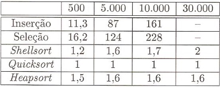</p>

<p align="center"><em>Ordem aleatória</em></p>

<p align="center">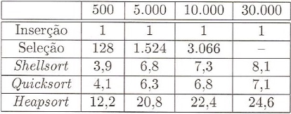</p>

<p align="center"><em>Já ordenado</em></p>

<p align="center">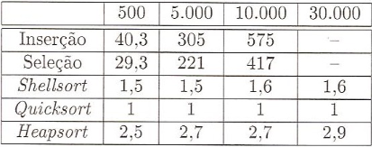</p>

<p align="center"><em>Ordem inversa</em></p>

| **Método** | **Melhor** | **Pior** | **Quando usar** |
|---|---|---|---|
| Insertion | $`n`$ | $`n^{2}`$ | Até cerca de 20 elementos ou quase ordenado; estável |
| Selection | $`n^{2}`$ | $`n^{2}`$ | Quando mover registros é caro (só $`\mathcal{O} (n)`$ trocas) |
| Shell | $`n \log n`$ | $`n^{\frac{3}{2}}`$ | Tamanho moderado; sem pior caso ruim |
| Heap | $`n \log n`$ | $`n \log n`$ | Garantia de $`n \log n`$ sem memória extra |
| Merge | $`n \log n`$ | $`n \log n`$ | Garantia de $`n \log n`$; estável; usa memória extra |
| Quick | $`n \log n`$ | $`n^{2}`$ | Mais rápido na prática; pivô pela mediana de três evita o pior caso |

## 3. Lista 2 - Complexidade

### 3.1. Ex. 1: menor $`n`$ com $`100 n^{2} < 2^{n}`$

Basta testar inteiros, pois a exponencial passa a quadrática e não volta mais:

| $`n`$ | $`100 n^{2}`$ | $`2^{n}`$ |  |
|---|---|---|---|
| 14 | 19 600 | 16 384 | ✗ |
| 15 | 22 500 | 32 768 | ✓ |

**Resposta:** $`n = 15`$.

> [!NOTE]
> **Solução analítica (função W de Lambert)**
>
> $`W`$ é a inversa de $`f (x) = x e^{x}`$: se $`x e^{x} = y`$, então $`x = W (y)`$.
>
> ```math
> 2^{n} = 100 n^{2} \Rightarrow e^{n \ln 2 / 2} = 10 n \Rightarrow \left( - \frac{\ln 2}{2} n \right) e^{- \frac{\ln 2}{2} n} = - \frac{\ln 2}{20}
> ```
>
> ```math
> n = - \frac{2}{\ln 2} W \left( - \frac{\ln 2}{20} \right) \approx 14.32 \quad \text{(ramo } W_{- 1} \text{)}
> ```
>
> O próximo inteiro é $`n = 15`$.

### 3.2. Ex. 2: "no mínimo $`\mathcal{O} (n^{2})`$"

$`\mathcal{O}`$ é um limite **superior**, então "no mínimo $`\mathcal{O} (n^{2})`$" não diz nada: qualquer algoritmo, até um de custo constante, é $`\mathcal{O} (n^{2})`$. Para um limite inferior, usa-se $`\Omega`$: "o tempo é $`\Omega (n^{2})`$".

### 3.3. Ex. 3: $`2^{n + 1} = \mathcal{O} (2^{n})`$? $`2^{2 n} = \mathcal{O} (2^{n})`$?

- $`2^{n + 1} = 2 \cdot 2^{n} \le c \cdot 2^{n}`$ com $`c = 2`$. **Sim.**
- $`2^{2 n} = 4^{n}`$, e $`4^{n} \le c \cdot 2^{n} \Leftrightarrow 2^{n} \le c`$, falso para $`n`$ grande. **Não.**

### 3.4. Ex. 5: $`T (n) = T (n - 1) + n`$ é $`\mathcal{O} (n^{2})`$

Expandindo a recorrência até a base $`T (1) = 1`$:

```math
T (n) = n + (n - 1) + \cdots + 2 + 1 = \sum_{i = 1}^{n} i = \frac{n (n + 1)}{2} = \mathcal{O} (n^{2})
```

# Cálculo III (SMA0355)

## 1. Integrais múltiplas

### 1.1. Integrais iteradas

Sejam $`a \le x \le b`$ ($`x \in [a , b]`$), $`c \le y \le d`$ ($`y \in [c , d]`$) e $`f (x , y)`$ contínua ou com saltos finitos.

1. Fixando $`y`$ e variando $`x`$, obtemos a **área** de uma fatia:

   ```math
   F (y) = \int_{a}^{b} f (x , y) \mathrm{d} x
   ```

   ($`F`$ é a antiderivada com $`y`$ fixo: área sob $`f`$ ao longo de $`x`$.)
1. Deslocando essa fatia em $`y`$, somamos as áreas e obtemos o **volume**:

   ```math
   \int_{c}^{d} F (y) \mathrm{d} y = \int_{c}^{d} \left[ \int_{a}^{b} f (x , y) \mathrm{d} x \right] \mathrm{d} y
   ```

   Se os limites em $`x`$ dependem de $`y`$, ao deslocar em $`y`$ a integral $`\int \mathrm{d} y`$ considera essa variação.

<p align="center">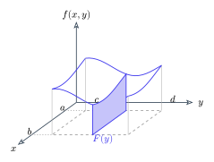</p>

*A fatia em $`y`$ tem área $`F (y)`$; somando as fatias de $`c`$ a $`d`$, temos o volume.*

> [!NOTE]
> **Integrais iteradas**
>
> Integrais iteradas calculam **volume**! Em particular, $`\iint 1 \mathrm{d} x \mathrm{d} y`$ calcula a **área** da região (área $`\times`$ altura 1).

### 1.2. Regiões não retangulares

As funções que limitam a região simplesmente viram os limites de integração, pois eles variam conforme nos deslocamos.

<p align="center">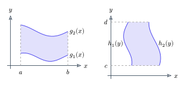</p>

*Caso 1 (esquerda): $`y`$ entre duas funções de $`x`$. Caso 2 (direita): $`x`$ entre duas funções de $`y`$.*

> [!NOTE]
> **Caso 1: $`y (x)`$, $`x \in [a , b]`$**
>
> $`g_{1} (x) \le y \le g_{2} (x)`$
>
> ```math
> \int_{a}^{b} \int_{g_{1} (x)}^{g_{2} (x)} f (x , y) \mathrm{d} y \mathrm{d} x
> ```

> [!NOTE]
> **Caso 2: $`x (y)`$, $`y \in [c , d]`$**
>
> $`h_{1} (y) \le x \le h_{2} (y)`$
>
> ```math
> \int_{c}^{d} \int_{h_{1} (y)}^{h_{2} (y)} f (x , y) \mathrm{d} x \mathrm{d} y
> ```

- Uma $`\iint`$ com os 4 limites sendo funções **não existe**: a integral mais externa sempre é um intervalo de constantes. Se não, sobrariam variáveis que não podem ser integradas.
- **Obs.:** integrais internas não podem ter limites com variáveis que já foram integradas.

> [!IMPORTANT]
> **Teorema de Fubini**
>
> Se $`f (x , y)`$ for contínua e a região de integração $`R = [a , b] \times [c , d]`$ for um retângulo, a ordem de integração não importa:
>
> ```math
> \iint_{R} f (x , y) \mathrm{d} A = \int_{a}^{b} \int_{c}^{d} f (x , y) \mathrm{d} y \mathrm{d} x = \int_{c}^{d} \int_{a}^{b} f (x , y) \mathrm{d} x \mathrm{d} y
> ```

### 1.3. Mudança de variáveis

O objetivo é **simplificar a região de integração**.

<p align="center">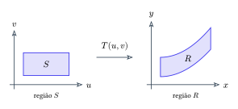</p>

*Uma região simples $`S`$ no plano $`u v`$ é levada por $`T`$ na região $`R`$ do plano $`x y`$.*

> [!IMPORTANT]
> **Teorema da mudança de variáveis**
>
> Seja $`f : D \subset \mathbb{R}^{2} \to \mathbb{R}`$ contínua e $`\phi : B \to D`$ de classe $`C^{1}`$ e injetora. Então
>
> ```math
> \text{Área} (\phi (B_{i j})) = | J | \text{área} (B_{i j})
> ```
>
> Ao passar da imagem para o domínio, o **jacobiano** faz o ajuste de escala (ex.: em polares, um intervalo que antes ia de 0 a 1 agora vai de 0 a $`2 \pi`$).

> [!NOTE]
> **Jacobiano**
>
> Para $`\phi (u , v) = (x (u , v) , y (u , v))`$:
>
> ```math
> J (\phi) = \begin{vmatrix} \frac{\partial x}{\partial u} & \frac{\partial y}{\partial u} & \cdots \\ \frac{\partial x}{\partial v} & \frac{\partial y}{\partial v} & \cdots \\ \vdots & \vdots & \ddots \end{vmatrix}
> ```

<p align="center">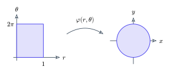</p>

*Coordenadas polares: o retângulo $`[0 , 1] \times [0 , 2 \pi]`$ vira o disco unitário.*

> [!TIP]
> **Exemplo**
>
> **Polares:** $`x (r , \theta) = r \cos \theta`$, $`y (r , \theta) = r \sin \theta`$.

- **Em Cálculo II:** com $`x = g (u)`$,

   ```math
   \int_{a}^{b} f (x) \mathrm{d} x = \int_{c}^{d} f (g (u)) g' (u) \mathrm{d} u
   ```

   Esse $`g' (u)`$ era o jacobiano!

> [!IMPORTANT]
> **Mudança de variáveis em Cálculo III**
>
> ```math
> \iint_{D} f (x , y) \mathrm{d} x \mathrm{d} y = \iint_{R} f (\phi (u , v)) | J (\phi) | \mathrm{d} u \mathrm{d} v
> ```
>
> A região de integração em $`R`$ tem que ser ajustada.

Achar o jacobiano é fácil quando você tem a função:
- **Elipse:** $`x = a r \cos \theta`$, $`y = b r \sin \theta \Rightarrow | J (\phi) | = r a b`$
- **Círculo:** $`| J (\phi) | = r`$

**Roteiro:** 1) identificar o sólido; 2) montar a integral; 3) decidir a mudança de variável.

> [!NOTE]
> **Coordenadas cilíndricas e esféricas**
>
> - **Cilíndricas:** $`\phi (r , \theta , z) = (r \cos \theta , r \sin \theta , z)`$, com $`| J (\phi) | = r`$, logo $`\mathrm{d} V = r \mathrm{d} r \mathrm{d} \theta \mathrm{d} z`$.
> - **Esféricas:** $`\phi (\rho , \theta , \phi) = (\rho \sin \phi \cos \theta , \rho \sin \phi \sin \theta , \rho \cos \phi)`$, com $`| J | = \rho^{2} \sin \phi`$. Aqui $`\theta`$ varia no plano $`x y`$ e $`\phi`$ é o ângulo com o eixo $`z`$ (altura).

<p align="center">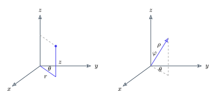</p>

<p align="center"><em>Coordenadas cilíndricas (esquerda) e esféricas (direita).</em></p>

### 1.4. Integral de volume e integral tripla

> [!NOTE]
> **Volume**
>
> ```math
> V (B) = \int_{B} 1 \mathrm{d} V
> ```
>
> Com $`\mathrm{d} x \mathrm{d} y`$, é a **área**; com $`\mathrm{d} x \mathrm{d} y \mathrm{d} z`$, é o **volume**.

- $`\iiint_{D} 1 \mathrm{d} x \mathrm{d} y \mathrm{d} z`$ calcula o volume (visto antes).
- $`\iiint_{D} f (x , y , z) \mathrm{d} x \mathrm{d} y \mathrm{d} z`$: aplicação no **cálculo de massa**, quando a densidade muda em função de $`x , y , z`$ (dada por $`f (x , y , z)`$).

> [!TIP]
> **Exemplo**
>
> Um disco mais denso na borda e menos denso no centro: $`f (x , y , z) = \sqrt{x^{2} + y^{2}}`$ (constante em $`z`$).

## 2. Aplicações de integrais duplas e triplas

### 2.1. Centro de massa

O **centro de massa** é o ponto onde poderíamos concentrar toda a massa do sistema **sem alterar o momento**: o ponto único que gera o mesmo torque que todos os outros pontos juntos.

```math
M x_{\text{cm}} = \sum m_{i} x_{i} \quad \rightarrow \quad \overline{x} = \frac{\sum m_{i} x_{i}}{M} \quad (M = \text{massa total})
```

> [!NOTE]
> **Lâmina com densidade $`\rho (x , y)`$**
>
> - **Massa:** $`{\displaystyle M = \int_{D} \rho (x , y) \mathrm{d} x \mathrm{d} y}`$
> - **Densidade média:** $`{\displaystyle \frac{\int_{D} \rho (x , y) \mathrm{d} V}{\int_{D} \mathrm{d} V}}`$ ($`\frac{\rho}{A}`$ ou $`\frac{\rho}{V}`$)
> - **Momentos:** $`{\displaystyle M_{x} = \int_{D} x \rho (x , y) \mathrm{d} A}`$, $`\quad {\displaystyle M_{y} = \int_{D} y \rho (x , y) \mathrm{d} A}`$
> - **Centro de massa:**
>
>    ```math
>    \overline{x} = \frac{M_{x}}{M} = \frac{\int_{D} x \rho (x , y) \mathrm{d} A}{\int_{D} \rho (x , y) \mathrm{d} A} , \quad \overline{y} = \frac{M_{y}}{M}
>    ```

Obs.: aqui $`M_{x}`$ é o momento ponderado por $`x`$. Muitos livros chamam esse mesmo momento de $`M_{y}`$ (momento em relação ao eixo $`y`$).

### 2.2. Momento de inércia

```math
I_{D} = \sum m_{i} d_{i}^{2} \quad (m_{i} \to \rho \mathrm{d} A)
```

> [!NOTE]
> **Momentos de inércia**
>
> ```math
> I_{x} = \int_{D} y^{2} \rho (x , y) \mathrm{d} A , \quad I_{y} = \int_{D} x^{2} \rho (x , y) \mathrm{d} A , \quad I_{z} = I_{x} + I_{y} \quad (d^{2} = x^{2} + y^{2})
> ```
>
> ($`I_{x}`$: a distância ao eixo $`x`$ é $`d = y`$; $`I_{y}`$: $`d = x`$.)

## 3. Curvas e integrais de linha

### 3.1. Parametrização de curvas

Parametrizações permitem usar as ferramentas do Cálculo; representam trajetórias.

> [!NOTE]
> **Curva parametrizada**
>
> ```math
> \gamma : [a , b] \to \mathbb{R}^{2} (\mathbb{R}^{3}) , \quad \gamma (t) = (x (t) , y (t)) \quad \text{ou} \quad \gamma (t) = (x (t) , y (t) , z (t))
> ```

- **Traço** de $`\gamma`$: $`\gamma ([a , b])`$.
- **Reta tangente** a $`\gamma`$ em $`t_{0}`$: $`X (\lambda) = \gamma (t_{0}) + \lambda \gamma' (t_{0})`$.
- **Curva regular:** $`\gamma' (t) \neq \vec{0} \ \forall t \in [a , b]`$. Se não, há pontos sem reta tangente.
- **Curva fechada:** $`\gamma (a) = \gamma (b)`$.

> [!NOTE]
> **Comprimento de arco**
>
> ```math
> \int_{\gamma} \mathrm{d} s = \int_{a}^{b} \left\lVert \gamma' (t) \right\rVert \mathrm{d} t
> ```
>
> Vem de $`\sum \text{lados} = \sum \left\lVert \gamma' (t) \right\rVert \Delta t`$ (T.V.M.). Obs.: para a poligonal aproximar o comprimento, todos os vértices dela devem estar na curva.

### 3.2. Integral de linha de campo escalar

> [!NOTE]
> **Integral de linha de campo escalar**
>
> ```math
> \int_{\gamma} f \mathrm{d} s = \int_{a}^{b} f (\gamma (t)) \left\lVert \gamma' (t) \right\rVert \mathrm{d} t
> ```
>
> - $`f (\gamma (t))`$: função aplicada nos pontos da curva.
> - $`\left\lVert \gamma' (t) \right\rVert`$: fator de correção que ajusta o comprimento do arco.
>
> Obs.: só funciona sobre curvas unidimensionais.

Ela é a **área da "cortina"** abaixo de $`f (x , y)`$ quando andamos sobre a curva (a integral simples $`\int f \mathrm{d} x`$ é o caso em que a curva é o eixo $`x`$).

<p align="center">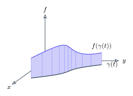</p>

*A integral de linha de $`f`$ é a área da cortina entre a curva $`\gamma`$ e o gráfico de $`f`$.*

### 3.3. Integral de linha de campos vetoriais (I.L.C.V.)

**Campo vetorial**, ex.: $`\vec{F} (x , y) = (- y , x)`$. Fornece um **vetor aplicado** em cada ponto $`(x_{0} , y_{0})`$ da trajetória.

A I.L.C.V. é o **trabalho** $`W = \vec{F} \cdot \vec{d}`$: fazemos o produto escalar do vetor aplicado em cada ponto da trajetória com um **vetor unitário na direção tangente** à curva, $`\vec{T} = \gamma' (t) / \left\lVert \gamma' (t) \right\rVert`$ (isso dá $`\left\lVert \vec{F} \right\rVert \cos \theta`$, pois $`\langle u , v \rangle = \left\lVert u \right\rVert \left\lVert v \right\rVert \cos \theta`$):

```math
W = \langle \vec{F} (\gamma (t)) , \frac{\gamma' (t)}{\left\lVert \gamma' (t) \right\rVert} \rangle \cdot \underbrace{\left\lVert \gamma' (t) \right\rVert \mathrm{d} t}_{\mathrm{d} s}
```

> [!NOTE]
> **Trabalho (I.L.C.V.)**
>
> ```math
> W = \int_{\gamma} \vec{F} \cdot \mathrm{d} \vec{r} = \int_{\gamma} \vec{F} \cdot \vec{T} \mathrm{d} s = \int_{a}^{b} \vec{F} (\gamma (t)) \cdot \gamma' (t) \mathrm{d} t
> ```
>
> Notação: $`{\displaystyle \int_{\gamma} \vec{F} \cdot \mathrm{d} \vec{r} = \int_{\gamma} P \mathrm{d} x + Q \mathrm{d} y + R \mathrm{d} z}`$ (o produto escalar entre $`\vec{F}`$ e $`\gamma'`$ já foi feito).

### 3.4. Campos conservativos

Um campo é **conservativo** quando $`\vec{F}`$ possui uma primitiva: a integral só depende do início e do fim.

> [!IMPORTANT]
> **Campo conservativo: condições equivalentes**
>
> 1. $`\exists \ \phi : \mathbb{R}^{3} \to \mathbb{R}`$ (função escalar, chamada **função potencial**) com
>
>    ```math
>    \nabla \phi = \left( \frac{\partial \phi}{\partial x} , \frac{\partial \phi}{\partial y} , \frac{\partial \phi}{\partial z} \right) = \vec{F} (x , y , z)
>    ```
>
> 1. $`\int_{\gamma} \vec{F} \cdot \mathrm{d} \vec{r}`$ não depende de $`\gamma (t)`$, só de $`\gamma (a)`$ (início) e $`\gamma (b)`$ (fim):
>
>    ```math
>    \int_{\gamma} \vec{F} \cdot \mathrm{d} \vec{r} = \phi (\gamma (b)) - \phi (\gamma (a))
>    ```
>
> 1. $`\oint_{\gamma} \vec{F} \cdot \mathrm{d} \vec{r} = 0`$ sobre **qualquer** curva fechada.

> [!TIP]
> **Exemplo**
>
> **Demonstração de (2).** Pela regra da cadeia, $`\frac{\mathrm{d}}{\mathrm{d} t} \phi (\gamma (t)) = \nabla \phi (\gamma (t)) \cdot \gamma' (t) = \langle \nabla \phi , \gamma' \rangle`$ (a derivada de $`\phi (x , y , z)`$ é o gradiente). Logo:
>
> ```math
> \int_{\gamma} \vec{F} \cdot \mathrm{d} \vec{r} = \int_{a}^{b} \langle \vec{F} , \gamma' \rangle \mathrm{d} t = \int_{a}^{b} \langle \nabla \phi , \gamma' \rangle \mathrm{d} t = \int_{a}^{b} \frac{\mathrm{d}}{\mathrm{d} t} \phi (\gamma (t)) \mathrm{d} t = \phi (\gamma (b)) - \phi (\gamma (a))
> ```
>
> pelo T.F.C.

### 3.5. Rotacional

> [!NOTE]
> **Rotacional**
>
> Para $`\vec{F} (x , y , z) = (P (x , y , z) , Q (x , y , z) , R (x , y , z))`$:
>
> ```math
> \text{rot} \vec{F} = \begin{vmatrix} \hat{i} & \hat{j} & \hat{k} \\ \frac{\partial}{\partial x} & \frac{\partial}{\partial y} & \frac{\partial}{\partial z} \\ P & Q & R \end{vmatrix} = \left( \frac{\partial R}{\partial y} - \frac{\partial Q}{\partial z} \right) \hat{i} + \left( \frac{\partial P}{\partial z} - \frac{\partial R}{\partial x} \right) \hat{j} + \left( \frac{\partial Q}{\partial x} - \frac{\partial P}{\partial y} \right) \hat{k}
> ```

Mede a **tendência de rotacionar em torno do ponto**, e não se a trajetória é reta ou circular:
- $`\vec{F} = (0 , x)`$ (trajetórias retas) $`\rightarrow \text{rot} \vec{F} = 1 \hat{k}`$
- $`\vec{F} = (- y , x)`$ (trajetórias circulares) $`\rightarrow \text{rot} \vec{F} = 2 \hat{k}`$

Se $`\vec{F}`$ é conservativo, $`\vec{F} = (P , Q , R) = \left( \frac{\partial \phi}{\partial x} , \frac{\partial \phi}{\partial y} , \frac{\partial \phi}{\partial z} \right)`$ e

```math
\text{rot} \vec{F} = \left( \frac{\partial}{\partial y} \left( \frac{\partial \phi}{\partial z} \right) - \frac{\partial}{\partial z} \left( \frac{\partial \phi}{\partial y} \right) \right) \hat{i} + (\cdots) \hat{j} + (\cdots) \hat{k} = \vec{0}
```

pelo **Teorema de Schwarz**, $`\frac{\partial}{\partial x} \left( \frac{\partial f}{\partial y} \right) = \frac{\partial}{\partial y} \left( \frac{\partial f}{\partial x} \right)`$ (vale para $`f`$ de classe $`C^{2}`$).

> [!IMPORTANT]
> **Conservativo implica rotacional nulo**
>
> Se $`\vec{F}`$ é conservativo, então $`\text{rot} \vec{F} = \vec{0}`$. **A volta não vale** necessariamente.

**Intuição para verificar se é conservativo:** $`\text{rot} \vec{F} = \vec{0}`$? Sim: calcule $`\phi`$ (potencial). Não: não é conservativo (não gaste tempo tentando achar $`\phi`$).

> [!NOTE]
> **Como achar $`\phi`$**
>
> Queremos $`\vec{F} = (P , Q) = \left( \frac{\partial \phi}{\partial x} , \frac{\partial \phi}{\partial y} \right)`$:
> - integrando $`P`$ em $`x`$: $`\phi = f (x , y) + g (y)`$ (o "$`C`$" depende de $`y`$);
> - integrando $`Q`$ em $`y`$: $`\phi = f (x , y) + h (x)`$.
>
> Comparamos as duas integrais para ver se existe um potencial compatível com ambas.

### 3.6. Teorema de Green

Podemos alternar entre olhar a **borda** e olhar o **interior** da curva fechada. Green só vale em $`\mathbb{R}^{2}`$.

> [!IMPORTANT]
> **Teorema de Green**
>
> Seja $`\vec{F} : D \subset \mathbb{R}^{2} \to \mathbb{R}^{2}`$, $`\vec{F} = (P , Q)`$ de classe $`C^{1}`$, e $`D`$ fechado, limitado, com fronteira $`\partial D`$ formada por um número finito de curvas fechadas, simples, regulares por partes, **disjuntas** (não se cruzam) e **orientadas positivamente**. Então
>
> ```math
> \oint_{\partial D} P \mathrm{d} x + Q \mathrm{d} y = \iint_{D} \underbrace{\left( \frac{\partial Q}{\partial x} - \frac{\partial P}{\partial y} \right)}_{\text{rotacional (2D)}} \mathrm{d} x \mathrm{d} y
> ```
>
> ou, equivalentemente,
>
> ```math
> \oint_{\partial D} \vec{F} \cdot \mathrm{d} \vec{r} = \iint_{D} \text{rot} \vec{F} \cdot \hat{k} \mathrm{d} A
> ```

**Orientação positiva:** ao percorrer a borda, a região fica **à esquerda**. Se tomarmos o sentido contrário, colocamos um sinal de $`-`$. Ex.: com a borda dividida em $`\gamma_{1} , \ldots , \gamma_{4}`$ e $`\gamma_{3} , \gamma_{4}`$ percorridas ao contrário,

```math
\int_{\partial D} P \mathrm{d} x = \int_{\gamma_{1}} P \mathrm{d} x + \int_{\gamma_{2}} P \mathrm{d} x - \int_{\gamma_{3}} P \mathrm{d} x - \int_{\gamma_{4}} P \mathrm{d} x
```

<p align="center">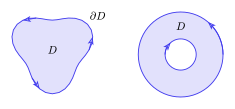</p>

<p align="center"><em>Orientação positiva: a região fica sempre à esquerda. Com um buraco, a curva interna é percorrida no sentido horário.</em></p>

**E para curvas não fechadas?** Fechamos a curva $`\gamma`$ com uma curva auxiliar $`\alpha`$ (ex.: um segmento) e descontamos $`\alpha`$ depois:

```math
\int_{\gamma} \vec{F} \cdot \mathrm{d} \vec{r} = \pm \iint_{D} \text{rot} \vec{F} \cdot \hat{k} \mathrm{d} A - \int_{\alpha} \vec{F} \cdot \mathrm{d} \vec{r}
```

(sinal $`+`$ se $`\gamma \cup \alpha`$ estiver orientada positivamente, $`-`$ se estiver ao contrário.)

#### E se $`\text{rot} \vec{F} = 0`$?

- **Sem singularidade dentro da curva fechada:** o campo é conservativo ali e $`\oint \vec{F} \cdot \mathrm{d} \vec{r} = 0`$ pelo teorema de Green.
- **Com singularidade dentro da curva:** usar Green diretamente está errado, pois um ponto da região não faz parte do domínio. Ex.: $`\vec{F} = (1 / x , 1 / y)`$.

Isolamos a singularidade com uma curva fechada $`\alpha`$, com orientação oposta (para fora da região):

```math
\int_{\gamma \cup \alpha} \vec{F} \cdot \mathrm{d} \vec{r} = \iint_{D} \underbrace{\text{rot} \vec{F}}_{0} \cdot \hat{k} \mathrm{d} A = 0 \quad \Rightarrow \quad \int_{\gamma} \vec{F} \cdot \mathrm{d} \vec{r} = - \int_{\alpha} \vec{F} \cdot \mathrm{d} \vec{r}
```

<p align="center">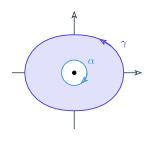</p>

*A singularidade na origem fica isolada pela curva $`\alpha`$ (orientação oposta a $`\gamma`$).*

### 3.7. Domínios simplesmente conexos

> [!NOTE]
> **Simplesmente conexo ($`\mathbb{R}^{2}`$)**
>
> $`D \subset \mathbb{R}^{2}`$ é simplesmente conexo se toda curva fechada em $`D`$ pode ser contraída a um ponto de $`D`$. Ex.: $`\mathbb{R}^{2} \setminus \{(0 , 0)\}`$ **não** é simplesmente conexo.

> [!IMPORTANT]
> **Rotacional nulo + simplesmente conexo implica conservativo**
>
> Se $`\vec{F} : D \subset \mathbb{R}^{2} \to \mathbb{R}^{2}`$ é um campo vetorial, $`D`$ é simplesmente conexo e $`\text{rot} \vec{F} = 0`$, então $`\vec{F}`$ é conservativo: $`{\displaystyle \int_{\gamma} \vec{F} (\gamma) \cdot \gamma' \mathrm{d} t = \phi_{2} - \phi_{1}}`$.
>
> Obs.: se existe função potencial, o campo é conservativo **somente no domínio da função**.

> [!TIP]
> **Exemplo**
>
> **Campo $`\mathrm{d} \theta`$:** $`\vec{F} (x , y) = \left( - \frac{y}{x^{2} + y^{2}} , \frac{x}{x^{2} + y^{2}} \right) \rightarrow \phi (x , y) = \arctan \left( \frac{y}{x} \right) = \theta`$.
>
> A integral $`\int_{\gamma} \vec{F} \cdot \mathrm{d} \vec{r}`$ é a variação de $`\theta`$ ao longo de $`\gamma`$. Como o domínio exclui a origem, uma volta em torno dela dá $`2 \pi`$, e não 0.

## 4. Superfícies e integrais de superfície

### 4.1. Superfícies parametrizadas em $`\mathbb{R}^{3}`$

> [!NOTE]
> **Superfície parametrizada**
>
> ```math
> X : D \subset \mathbb{R}^{2} \to \mathbb{R}^{3} , \quad X (u , v) = (x (u , v) , y (u , v) , z (u , v))
> ```

<p align="center">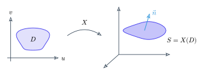</p>

*A parametrização $`X`$ leva a região $`D`$ do plano $`u v`$ na superfície $`S`$.*

- **Vetores tangentes** em um ponto da superfície:

   ```math
   X_{u} = \left( \frac{\partial x}{\partial u} , \frac{\partial y}{\partial u} , \frac{\partial z}{\partial u} \right) \quad (\text{fixa} v) , \quad \quad X_{v} = \left( \frac{\partial x}{\partial v} , \frac{\partial y}{\partial v} , \frac{\partial z}{\partial v} \right) \quad (\text{fixa} u)
   ```

- **Superfície regular:** $`X_{u}`$ e $`X_{v}`$ são L.I., ou seja, $`X_{u} \wedge X_{v} \neq \vec{0}`$.
- **Plano tangente:** $`X = X (u_{0} , v_{0}) + \lambda X_{u} + \mu X_{v}`$.

> [!NOTE]
> **Área de superfície**
>
> ```math
> \text{Área} (S) = \iint_{D} \left\lVert X_{u} \wedge X_{v} \right\rVert \mathrm{d} u \mathrm{d} v
> ```
>
> (cada pedacinho é o paralelogramo de lados $`X_{u} \Delta u`$ e $`X_{v} \Delta v`$, de área $`\left\lVert X_{u} \wedge X_{v} \right\rVert \Delta u \Delta v`$.)
>
> Obs. (G.A.): $`\overset{2}{\left\lVert \vec{u} \wedge \vec{v} \right\rVert} = \langle u , u \rangle \langle v , v \rangle - \langle u , v \rangle^{2} = \overset{2}{\left\lVert u \right\rVert} \overset{2}{\left\lVert v \right\rVert} - \langle u , v \rangle^{2}`$.

> [!NOTE]
> **Integral de superfície de campo escalar**
>
> ```math
> \iint_{D} \delta (x (u , v) , y (u , v) , z (u , v)) \left\lVert X_{u} \wedge X_{v} \right\rVert \mathrm{d} u \mathrm{d} v
> ```
>
> (ex.: $`\delta`$ = densidade, $`\delta : \mathbb{R}^{3} \to \mathbb{R}`$).

### 4.2. Orientação e fluxo

> [!NOTE]
> **Orientação de uma superfície regular**
>
> ```math
> \vec{n} (u , v) = \frac{X_{u} \wedge X_{v}}{\left\lVert X_{u} \wedge X_{v} \right\rVert} \quad \text{(vetor normal unitário)}
> ```
>
> O vetor normal define a face (o lado) da superfície. $`S`$ é **orientável** se existe uma escolha contínua de vetores normais em $`S`$. (A faixa de Möbius não é orientável.)

> [!NOTE]
> **Fluxo de $`\vec{F}`$ através de $`S`$**
>
> Para $`S`$ orientada e $`S \subset \text{dom} (\vec{F})`$:
>
> ```math
> \iint_{S} \vec{F} \cdot \vec{n} \mathrm{d} S = \iint_{D} \langle \vec{F} , \frac{X_{u} \wedge X_{v}}{\left\lVert X_{u} \wedge X_{v} \right\rVert} \rangle \left\lVert X_{u} \wedge X_{v} \right\rVert \mathrm{d} u \mathrm{d} v
> ```
>
> ```math
> \iint_{S} \vec{F} \cdot \vec{n} \mathrm{d} S = \iint_{D} \langle \vec{F} (X (u , v)) , X_{u} \wedge X_{v} \rangle \mathrm{d} u \mathrm{d} v
> ```
>
> (ex.: o líquido que atravessa uma placa.)
>
> Notação: $`{\displaystyle \iint_{S} P \mathrm{d} y \wedge \mathrm{d} z + Q \mathrm{d} z \wedge \mathrm{d} x + R \mathrm{d} x \wedge \mathrm{d} y}`$, com $`P , Q , R`$ multiplicando a 1ª, 2ª e 3ª componentes da normal.

### 4.3. Divergente e Teorema de Gauss

> [!NOTE]
> **Divergente**
>
> ```math
> \text{div} \vec{F} = \frac{\partial P}{\partial x} + \frac{\partial Q}{\partial y} + \frac{\partial R}{\partial z}
> ```
>
> Mede a quantidade de massa que sai da superfície de um bloquinho de volume (é positivo quando sai massa).

> [!IMPORTANT]
> **Teorema de Gauss (divergência)**
>
> Seja $`\vec{F} : V \subset \mathbb{R}^{3} \to \mathbb{R}^{3}`$ e $`\partial V`$ uma superfície regular por partes, orientada pela normal **para fora**. Então
>
> ```math
> \iiint_{V} \text{div} \vec{F} \mathrm{d} V = \iint_{\partial V} \vec{F} \cdot \vec{n} \mathrm{d} S
> ```
>
> Olhar só para a casca (o fluxo que atravessa a superfície) equivale a olhar para cada cantinho do volume e ver quanto sai/entra.

**E se a superfície não for um sólido fechado (sem tampa)?** Adicionamos a tampa $`S_{1}`$, de modo que $`\partial V = S \cup S_{1}`$:

> [!NOTE]
> **Gauss sem tampa**
>
> ```math
> \iint_{S} \vec{F} \cdot \vec{n} \mathrm{d} S = \iiint_{V} \text{div} \vec{F} \mathrm{d} V - \iint_{S_{1}} \vec{F} \cdot \vec{n} \mathrm{d} S_{1}
> ```

- Em Gauss, $`X_{u} \wedge X_{v}`$ tem que ter orientação positiva (para fora).
- Em Gauss não se aplica $`\text{div} \vec{F} (S)`$: é simplesmente $`\text{div} \vec{F}`$ nas coordenadas escolhidas. Se fizer mudança de coordenadas, use o jacobiano.

> [!TIP]
> **Exemplo**
>
> **Campo ângulo sólido ($`\mathrm{d} \Omega`$ em $`\mathbb{R}^{3}`$):** $`\vec{F} = \frac{\vec{r}}{r^{3}}`$, com $`\vec{r} = (x , y , z)`$ e $`r = | \vec{r} | = \sqrt{x^{2} + y^{2} + z^{2}}`$. Domínio: $`\mathbb{R}^{3} \setminus \{(0 , 0 , 0)\}`$. É o análogo 3D do campo $`\mathrm{d} \theta`$.

### 4.4. Superfícies com bordo

> [!NOTE]
> **Superfície com bordo**
>
> 1. O bordo de $`S`$ é formado por curvas regulares por partes.
> 1. As curvas do bordo são percorridas uma única vez.
> 1. $`\partial S \subset X (\partial D)`$.

- **Esfera:** não tem bordo ($`\partial S = \emptyset`$).
- **Cilindro / cubo:** ao colar as partes (faces), as costuras são percorridas 2 vezes, em sentidos opostos, e se cancelam. Só sobram os bordos de verdade.
- **Orientação do bordo:** a orientação coerente entre $`S`$ e $`\partial S`$ é dada pela **regra da mão direita** ($`\vec{n}`$ saindo da superfície).

### 4.5. Teorema de Stokes

> [!IMPORTANT]
> **Teorema de Stokes**
>
> Seja $`\vec{F} : V \subset \mathbb{R}^{3} \to \mathbb{R}^{3}`$ um campo vetorial e $`S`$ uma superfície parametrizada regular por partes, com $`S`$ e $`\partial S`$ orientadas coerentemente. Então
>
> ```math
> \iint_{S} \text{rot} \vec{F} \cdot \vec{n} \mathrm{d} S = \oint_{\partial S} \vec{F} \cdot \mathrm{d} \vec{r} \quad \text{(integral do tipo trabalho)}
> ```

- $`\text{div} (\text{rot} \vec{F}) = 0`$ e $`\text{rot} (\nabla f) = \vec{0}`$.
- Superfícies diferentes com o mesmo bordo dão o mesmo resultado: basta escolher a superfície mais fácil.
- O sentido de $`\vec{n}`$ é importante: se $`X_{u} \wedge X_{v}`$ der um $`\vec{n}`$ contrário à orientação, trabalhe com $`- \vec{n}`$.

> [!NOTE]
> **Simplesmente conexo ($`\mathbb{R}^{3}`$)**
>
> $`A \subset \mathbb{R}^{3}`$ é simplesmente conexo se:
> 1. qualquer curva fechada simples pode ser contraída a um ponto em $`A`$;
> 1. qualquer curva fechada simples é bordo de uma superfície em $`A`$.

> [!IMPORTANT]
> **Rotacional nulo + simplesmente conexo implica conservativo**
>
> Se $`\text{dom} \vec{F}`$ é simplesmente conexo em $`\mathbb{R}^{3}`$ e $`\text{rot} \vec{F} = \vec{0}`$, então $`\vec{F}`$ é conservativo.

> [!TIP]
> **Exemplo**
>
> **E se não for simplesmente conexo?** Ex.: $`\mathbb{R}^{3} \setminus \text{eixo} z`$. Usamos um cilindro que não toca o eixo $`z`$, com 2 bordos: a curva $`\gamma`$ que queremos e a curva $`\gamma_{1}`$ (projetada no plano $`x y`$) percorrida ao contrário:
>
> ```math
> \iint_{\text{cilindro}} \underbrace{\text{rot} \vec{F}}_{0} \cdot \vec{n} \mathrm{d} S = \int_{\gamma \cup \gamma_{1}} \vec{F} \cdot \mathrm{d} \vec{r} = 0 \quad \Rightarrow \quad \int_{\gamma} \vec{F} \cdot \mathrm{d} \vec{r} = - \int_{\gamma_{1}} \vec{F} \cdot \mathrm{d} \vec{r}
> ```

### 4.6. Integral de fluxo no plano

Para uma superfície $`X (u , v)`$, a integral de fluxo é

```math
\iint_{S} \vec{F} \cdot \underbrace{\frac{X_{u} \wedge X_{v}}{\left\lVert X_{u} \wedge X_{v} \right\rVert}}_{\vec{n}} \underbrace{\left\lVert X_{u} \wedge X_{v} \right\rVert \mathrm{d} u \mathrm{d} v}_{\mathrm{d} S} = \iint_{S} \vec{F} (P , Q , R) \cdot (X_{u} \wedge X_{v}) \mathrm{d} u \mathrm{d} v
```

Para uma curva $`\gamma (t) = (x (t) , y (t))`$ no plano, o vetor tangente é $`(x' , y')`$ e a normal unitária é perpendicular a ele ($`\vec{n} \cdot \gamma' = 0`$):

```math
\vec{n} = \frac{y' , - x'}{\left\lVert \gamma' (t) \right\rVert} \quad \Rightarrow \quad \int_{\gamma} \vec{F} (P , Q) \cdot \frac{y' , - x'}{\left\lVert \gamma' (t) \right\rVert} \left\lVert \gamma' (t) \right\rVert \mathrm{d} t = \int_{\gamma} P \mathrm{d} y - Q \mathrm{d} x
```

> [!NOTE]
> **Fluxo × trabalho no plano**
>
> - **Fluxo** (componente normal): $`{\displaystyle \int_{\gamma} \vec{F} \cdot \vec{n} \mathrm{d} s = \int_{\gamma} P \mathrm{d} y - Q \mathrm{d} x}`$ ($`R = 0`$)
> - **Trabalho** (componente tangencial): $`{\displaystyle \int_{\gamma} \vec{F} \cdot \mathrm{d} \vec{r} = \int_{\gamma} P \mathrm{d} x + Q \mathrm{d} y}`$

> [!IMPORTANT]
> **Teorema da divergência no plano (Green para fluxo)**
>
> É o Teorema de Gauss com $`R = 0`$ (em 2D, o volume vira área e $`\partial V`$ vira a curva):
>
> ```math
> \oint_{\gamma} \vec{F} \cdot \vec{n} \mathrm{d} s = \iint_{D} \text{div} \vec{F} \mathrm{d} A
> ```

## 5. Resumão

| **O quê** | **Fórmula** | **Lembrar** |
|---|---|---|
| Integral de linha (trabalho) | $`\int_{\gamma} \vec{F} (\gamma) \cdot \gamma' (t) \mathrm{d} t`$ | Se $`\text{rot} \vec{F} = 0`$ e o domínio é simplesmente conexo, use o potencial $`\phi`$ |
| Rotacional | $`\begin{vmatrix} \hat{i} & \hat{j} & \hat{k} \\ \partial_{x} & \partial_{y} & \partial_{z} \\ P & Q & R \end{vmatrix}`$ | $`P`$ nunca é derivado em $`x`$ |
| Divergente | $`\frac{\partial P}{\partial x} + \frac{\partial Q}{\partial y} + \frac{\partial R}{\partial z}`$ | Positivo quando sai massa |
| Green (trabalho, 2D) | $`\oint_{\partial D} \vec{F} \cdot \mathrm{d} \vec{r} = \iint_{D} \text{rot} \vec{F} \cdot \hat{k} \mathrm{d} A`$ | Só para curvas fechadas; região à esquerda; isole singularidades |
| Área de superfície | $`\iint_{D} \left\lVert X_{u} \wedge X_{v} \right\rVert \mathrm{d} u \mathrm{d} v`$ | $`\mathrm{d} S = \left\lVert X_{u} \wedge X_{v} \right\rVert \mathrm{d} u \mathrm{d} v`$ |
| Superfície, campo escalar | $`\iint_{D} \delta (X (u , v)) \left\lVert X_{u} \wedge X_{v} \right\rVert \mathrm{d} u \mathrm{d} v`$ | $`\delta : \mathbb{R}^{3} \to \mathbb{R}`$ |
| Fluxo por superfície | $`\iint_{D} \vec{F} (X (u , v)) \cdot (X_{u} \wedge X_{v}) \mathrm{d} u \mathrm{d} v`$ | Confira o sentido de $`\vec{n}`$ |
| Fluxo por curva (2D) | $`\int_{\gamma} P \mathrm{d} y - Q \mathrm{d} x`$ | $`\vec{n} \propto (y' , - x')`$ |
| Gauss | $`\iiint_{V} \text{div} \vec{F} \mathrm{d} V = \iint_{\partial V} \vec{F} \cdot \vec{n} \mathrm{d} S`$ | Normal para fora; sem tampa: Gauss $`-`$ tampa |
| Green para fluxo (2D) | $`\oint_{\gamma} \vec{F} \cdot \vec{n} \mathrm{d} s = \iint_{D} \text{div} \vec{F} \mathrm{d} A`$ | Gauss com $`R = 0`$ |
| Stokes | $`\oint_{\partial S} \vec{F} \cdot \mathrm{d} \vec{r} = \iint_{S} \text{rot} \vec{F} \cdot \vec{n} \mathrm{d} S`$ | Regra da mão direita; em 2D é Green |

# Equações Diferenciais Ordinárias (SME0340)

## 1. Introdução

- $`\frac{\mathrm{d} y}{\mathrm{d} x} + y = 8 x - 7`$, onde $`y`$ é a **variável dependente** e $`x`$ a **variável independente**.
- **Ordem da EDO** = ordem da maior derivada.
- Notação de derivada: $`y^{(n)} = \frac{\mathrm{d}^{n} y}{\mathrm{d} t^{n}}`$.

> [!NOTE]
> **EDO linear**
>
> Uma EDO de ordem $`n`$ é linear se pode ser escrita como
>
> ```math
> F (t , y , \ldots , y^{(n)}) = a_{0} (t) y^{(n)} + a_{1} (t) y^{(n - 1)} + \cdots + a_{n} (t) y - g (t)
> ```
>
> Se aparecer $`y^{2}`$, $`\ln | y |`$, $`\sin (y)`$, etc., a EDO **não é linear**.

### 1.1. Problema de Valor Inicial (PVI)

```math
\begin{cases} y' = f (t , y) \\ y (t_{0}) = y_{0} \end{cases}
```

> [!IMPORTANT]
> **Teorema de Peano**
>
> Se $`f`$ é contínua $`\forall (t_{0} , y_{0}) \in \mathbb{R}^{2}`$, existe **pelo menos uma** solução.

> [!IMPORTANT]
> **Teorema de Existência e Unicidade (T.E.U.)**
>
> Se $`f (t , y)`$ e $`\frac{\partial f}{\partial y} (t , y)`$ forem contínuas no intervalo, então o PVI **tem solução única**.
>
> Cuidado: o T.E.U. só vale em PVIs.

Pelo T.E.U., as funções solução **não se interseccionam**:

<p align="center">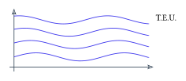</p>

<p align="center"><em>Soluções distintas de um PVI nunca se cruzam.</em></p>

## 2. EDOs de 1ª ordem

### 2.1. EDOs separáveis

> [!NOTE]
> **EDO separável**
>
> Se $`f (t , y) = h (t) g (y)`$, a EDO $`y' = h (t) g (y)`$ é separável.

1. **Soluções constantes:** se $`y (t) = c`$ anula $`g`$ (isto é, $`g (c) = 0`$), então $`y (t) = c`$ é solução constante.
1. **Soluções não constantes:** considerando $`y' = g (y) h (t)`$ e sendo $`y (t)`$ solução, segue da definição de diferencial que

   ```math
   \mathrm{d} y = y' (t) \mathrm{d} t \quad \Rightarrow \quad \mathrm{d} \frac{y}{g} (y) = h (t) \mathrm{d} t
   ```

   Esse é o **método de separação de variáveis**. Depois, integra!

### 2.2. EDOs lineares de 1ª ordem

> [!NOTE]
> **Forma padrão**
>
> ```math
> y' + a (t) y = b (t)
> ```

1. Calcula a função auxiliar (**fator integrante**):

   ```math
   \mu (t) = e^{\int a (t) \mathrm{d} t}
   ```

1. Multiplica a equação por $`\mu (t)`$:

   ```math
   \underbrace{y' e^{\int a (t) \mathrm{d} t} + a (t) y e^{\int a (t) \mathrm{d} t}}_{\frac{\mathrm{d}}{\mathrm{d} t} \left( y e^{\int a (t) \mathrm{d} t} \right)} = b (t) e^{\int a (t) \mathrm{d} t}
   ```

1. Integra dos dois lados (pelo T.F.C.):

   ```math
   \int \frac{\mathrm{d}}{\mathrm{d} t} \left( y e^{\int a (t) \mathrm{d} t} \right) \mathrm{d} t = \int b (t) e^{\int a (t) \mathrm{d} t} \mathrm{d} t
   ```

> [!NOTE]
> **Solução**
>
> ```math
> y \mu (t) = \int b (t) e^{\int a (t) \mathrm{d} t} \mathrm{d} t + C
> ```
>
> Não esquecer da constante $`C`$!

### 2.3. EDOs não lineares de 1ª ordem

#### Equação de Bernoulli

> [!NOTE]
> **Forma geral**
>
> ```math
> y' + a (t) y = b (t) y^{n}
> ```
>
> ($`n > 1`$: não linear)

Transformamos em algo linear:

1. Divide por $`y^{n}`$: $`\quad y' y^{- n} + a (t) y^{1 - n} = b (t)`$
1. Substitui $`z = y^{1 - n}`$, logo $`z' = (1 - n) y^{- n} y'`$, ou seja, $`{\displaystyle \frac{z'}{1 - n} = y^{- n} y'}`$.
1. Substitui na original e resolve como se fosse linear de 1ª ordem:

   ```math
   \frac{z'}{1 - n} + a (t) z = b (t)
   ```

   É linear! (Ao achar $`z`$, acha $`y`$.)

#### Equação de Riccati

> [!NOTE]
> **Forma geral**
>
> ```math
> y' + a (t) y + b (t) y^{2} = f (t)
> ```
>
> (Se $`f (t) = 0`$, é Bernoulli.)

Tomamos $`y_{1} (t)`$ uma solução conhecida e fazemos

```math
y = y_{1} + \frac{1}{z} \quad \Rightarrow \quad y' = y'_{1} - \frac{z'}{z^{2}} , \quad y^{2} = y_{1}^{2} + \frac{2 y_{1}}{z} + \frac{1}{z^{2}}
```

Substituindo na original, obtemos:

```math
z' = \underbrace{[a (t) + 2 b (t) y_{1}]}_{h (t)} z + b (t)
```

- Riccati se transforma em uma EDO linear de 1ª ordem.
- Ao aplicar Riccati, $`f (t)`$ zera.

## 3. Aplicações

### 3.1. Problemas de crescimento / decaimento

Seja $`N = N (t)`$ a lei que descreve a evolução de um fenômeno em $`\Delta t`$, e a taxa de variação seja proporcional à quantidade presente:

```math
\frac{\mathrm{d} N}{\mathrm{d} t} = k N \quad \rightarrow \quad N (t) = C e^{k t}
```

($`k`$: constante de proporcionalidade.)

### 3.2. Lei do resfriamento / aquecimento de Newton

A taxa de variação da temperatura no tempo é proporcional à diferença de temperatura entre o corpo e o meio:

```math
\frac{\mathrm{d} T}{\mathrm{d} t} = k (T_{\text{corpo}} - T_{\text{ambiente}}) \quad \rightarrow \quad T (t) = C e^{k t} + T_{m}
```

($`T_{\text{ambiente}} = T_{m}`$ considerado constante.)

### 3.3. Diluição

A taxa de variação da quantidade de sal no tanque é igual à taxa que entra menos a taxa que sai:

| $`\alpha`$ l/min, $`b`$ kg/l | $`Q (t)`$ | $`\beta`$ l/min |
|---|---|---|
| *entrada* | *sal no tanque* | *saída* |

```math
\frac{\mathrm{d} Q}{\mathrm{d} t} = \alpha b - C (t) \beta
```

onde $`C (t)`$ é a concentração no tanque:

```math
\frac{\mathrm{d} Q}{\mathrm{d} t} = \alpha b - \underbrace{\frac{Q (t)}{V_{0} + \alpha t - \beta t}}_{\text{concentração (kg/l) no tanque}} \beta
```

## 4. EDOs de 2ª ordem

> [!NOTE]
> **Homogênea e não homogênea**
>
> - $`x'' + a (t) x' + b (t) x = 0 \quad \rightarrow`$ EDO **homogênea** (H)
> - $`x'' + a (t) x' + b (t) x = f (t) \quad \rightarrow`$ EDO **não homogênea** (NH)

### 4.1. EDOs de 2ª ordem homogêneas

> [!IMPORTANT]
> **T.E.U. para PVI**
>
> ```math
> \begin{cases} x'' + a (t) x' + b (t) x = f (t) \\ x (t_{0}) = \alpha \\ x' (t_{0}) = \beta \end{cases}
> ```
>
> Se $`a , b , f`$ são contínuas, então o PVI possui **solução única**.

> [!IMPORTANT]
> **Princípio da superposição**
>
> Se $`x_{1} , x_{2}`$ são soluções da EDO (H) de 2ª ordem, então a combinação linear
>
> ```math
> \phi (t) = C_{1} x_{1} (t) + C_{2} x_{2} (t)
> ```
>
> também é solução de H.
>
> Obs.: $`\{x_{1} (t) , x_{2} (t)\}`$ é a base das soluções da EDO.

> [!NOTE]
> **Wronskiano**
>
> Verifica se $`x_{1} , x_{2}`$ são L.I. (para formar base):
>
> ```math
> W (x_{1} , x_{2}) (t) = \begin{vmatrix} x_{1} (t) & x_{2} (t) \\ x'_{1} (t) & x'_{2} (t) \end{vmatrix}
> ```
>
> - $`W \neq 0`$: L.I.
> - $`W = 0`$: L.D.

> [!IMPORTANT]
> **Teorema de Abel**
>
> ```math
> W (x_{1} , x_{2}) (t) = C e^{- \int a (t) \mathrm{d} t}
> ```
>
> Não depende de $`t`$, só de $`x_{1} , x_{2}`$.
> - Evita ter que achar soluções para saber se a base é L.I.
> - $`a (t)`$ é o coeficiente de $`x'`$ (o coeficiente do 2º maior).
> - Para determinar $`C`$, calculamos $`W`$ no ponto $`t_{0}`$.

### 4.2. EDOs (H, 2ª ordem) com coeficientes constantes

```math
x'' + a x' + b x = 0
```

Ao aplicar $`x (t) = e^{\lambda t}`$ (solução genérica), obtemos a **equação característica**:

> [!NOTE]
> **Equação característica**
>
> ```math
> \lambda^{2} + a \lambda + b = 0
> ```
>
> Achando $`\lambda`$, achamos $`x_{1}`$ e $`x_{2}`$.

- **Caso $`\Delta > 0`$:** $`W \neq 0`$ ($`\lambda_{1} \neq \lambda_{2}`$).

   ```math
   x_{H} (t) = C_{1} e^{\lambda_{1} t} + C_{2} e^{\lambda_{2} t}
   ```

- **Caso $`\Delta = 0`$:** $`\lambda_{1} = \lambda_{2}`$, então $`W = 0`$. Usamos

   ```math
   x_{1} (t) = e^{\lambda t} , \quad x_{2} (t) = t e^{\lambda t}
   ```

   pois $`W (x_{1} , x_{2}) (t) \neq 0`$ (é solução e é L.I.!). Para multiplicidade 3, $`x_{3} = t^{2} e^{\lambda t}`$.

Por soma e produto: $`\lambda + \lambda = - \frac{a}{1} \quad \Rightarrow \quad \lambda = - \frac{a}{2}`$.
- **Caso $`\Delta < 0`$:** se $`\lambda = \alpha \pm i \beta`$ ($`\beta \neq 0`$),

   ```math
   x_{1} (t) = e^{\alpha t} \cos (\beta t) , \quad x_{2} (t) = e^{\alpha t} \sin (\beta t)
   ```

Obs.: o $`\pm`$ não importa (usa-se $`e^{(\alpha + i \beta) t}`$ como solução e a identidade de Euler $`e^{i \theta} = \cos \theta + i \sin \theta`$, $`\theta \in \mathbb{R}`$).

```math
W (x_{1} , x_{2}) = \beta e^{2 \alpha t} \neq 0
```

### 4.3. Teorema de Abel (ordem $`n`$)

> [!IMPORTANT]
> **Teorema de Abel para ordem n**
>
> Para EDO de ordem $`n`$ na forma
>
> ```math
> y^{(n)} + p_{n - 1} y^{(n - 1)} + \cdots + p_{0} (x) y = 0
> ```
>
> ```math
> W (x) = C e^{- \int a (x) \mathrm{d} x}
> ```
>
> onde $`a (x)`$ é **sempre** $`p_{n - 1}`$ (se for 0, temos $`W (x) = C`$).

- Sem achar as soluções, Abel nos dá a forma final do Wronskiano (comportamento).
- Se $`W (0) = 0`$, Abel garante que $`W (t) = 0`$ em todos os pontos (o mesmo para $`W (0) \neq 0`$).
- Se $`W (t) = C t`$, por exemplo, então $`t = 0`$ é um ponto de descontinuidade (função original: $`a (t) = \frac{1}{t}`$).

> [!TIP]
> **Exemplo**
>
> **Uso de Abel para calcular o Wronskiano geral.** Se temos $`y'' + e^{x} y' + (x^{2} + 1) y = 0`$ e $`W (0) = 5`$, qual é $`W (10)`$?
>
> ```math
> W (x) = C e^{- e^{x}} \quad \text{(por Abel)}
> ```
>
> ```math
> W (0) = 5 = C e^{- 1} \rightarrow C = 5 e \rightarrow W (x) = 5 e \cdot e^{- e^{x}}
> ```
>
> que é o Wronskiano em qualquer ponto.

> [!TIP]
> **Exemplo**
>
> **Uso de Abel para achar a 2ª solução.** Se temos
>
> ```math
> y'' - \left( \frac{x + 2}{x} \right) y' + \left( \frac{x + 2}{x^{2}} \right) y = 0
> ```
>
> e sabemos que $`y_{1} (x) = x`$ é solução:
>
> ```math
> W (x) = C x^{2} e^{x} \quad \text{(por Abel)} \quad \text{e} \quad W (x) = y_{1} y'_{2} - y_{2} y'_{1} = x y'_{2} - y_{2}
> ```
>
> Igualando os dois: $`C x^{2} e^{x} = x y'_{2} - y_{2}`$.
>
> Admite-se $`C = 1`$ (qualquer múltiplo da solução L.I. também é L.I.):
>
> ```math
> y'_{2} - \frac{1}{x} y_{2} = x e^{x} \quad \rightarrow \text{EDO linear de 1ª ordem}
> ```

### 4.4. Resolução de EDOs não homogêneas de 2ª ordem

```math
x'' + a (t) x' + b (t) x = f (t) \quad \text{(NH)}
```

> [!NOTE]
> **Solução geral**
>
> ```math
> x (t) = \underbrace{x_{H} (t)}_{C_{1} x_{1} (t) + C_{2} x_{2} (t)} + x_{p} (t)
> ```
>
> onde $`x_{H}`$ é a solução da EDO (H), sem $`f (t)`$.

Pois, se aplicarmos $`[x (t) - x_{p} (t)]`$ na EDO, teremos:

```math
\underbrace{(x'' (t) + a (t) x' (t) + b (t) x (t))}_{f (t)} - \underbrace{(x''_{p} (t) + a (t) x'_{p} (t) + b (t) x_{p} (t))}_{f (t)} = 0
```

> [!IMPORTANT]
> **Teorema da variação dos parâmetros (achar $`x_{p}`$)**
>
> Seja $`\{x_{1} (t) , x_{2} (t)\}`$ base de soluções da EDO (H) linear de 2ª ordem. Então
>
> ```math
> x_{p} (t) = x_{1} (t) \int \frac{W_{1} (t) f (t)}{W (x_{1} , x_{2}) (t)} \mathrm{d} t + x_{2} (t) \int \frac{W_{2} (t) f (t)}{W (x_{1} , x_{2}) (t)} \mathrm{d} t
> ```
>
> onde $`W_{n} (t)`$ é o Wronskiano com a coluna $`n`$ cheia de zeros e o último número $`1`$:
>
> ```math
> W_{1} (t) = \begin{vmatrix} 0 & x_{2} (t) \\ 1 & x'_{2} (t) \end{vmatrix}
> ```

- Em $`x_{p}`$, não precisa de $`C`$ (considera-se $`C = 0`$), pois apenas buscamos uma solução particular.
- Esse teorema se expande para EDOs lineares de ordem $`n`$.

## 5. EDOs de ordem $`n`$

> [!IMPORTANT]
> **T.E.U. (geral)**
>
> Se $`p_{1} , p_{2} , \ldots , p_{n} , f`$ são contínuas no intervalo, então o PVI
>
> ```math
> \begin{cases} x^{(n)} + p_{1} (t) x^{(n - 1)} + \cdots + p_{n - 1} (t) x' + p_{n} (t) x = f (t) \\ x (t_{0}) = \alpha_{0} \\ x' (t_{0}) = \alpha_{1} \\ \vdots \\ x^{(n - 1)} (t_{0}) = \alpha_{n - 1} \end{cases}
> ```
>
> possui **solução única**! (Ordem $`n`$: $`n`$ pontos de definição.)

### 5.1. Números complexos

> [!NOTE]
> **Forma polar**
>
> ```math
> z = x + i y , \quad z = | z | (\cos \theta + i \sin \theta)
> ```

<p align="center">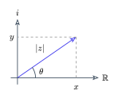</p>

*Representação de $`z`$ no plano complexo.*

### 5.2. Radiciação complexa

> [!NOTE]
> **2ª fórmula de De Moivre**
>
> ```math
> \sqrt[n]{z} = \sqrt[n]{| z |} \left( \cos \left( \frac{\theta + 2 k \pi}{n} \right) + i \sin \left( \frac{\theta + 2 k \pi}{n} \right) \right)
> ```
>
> com $`k = 0 , 1 , 2 , \ldots , n - 1`$ (são as raízes!).

De onde vem a 2ª fórmula de De Moivre? As raízes são os vértices de um **polígono regular** inscrito na circunferência de raio $`\sqrt[n]{| z |}`$. Exemplo: $`\sqrt[3]{- 1}`$.

<p align="center">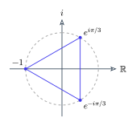</p>

*As 3 raízes cúbicas de $`- 1`$ formam um triângulo equilátero.*

### 5.3. Método das raízes racionais

- Ache os divisores de $`a_{n}`$ (coeficiente do maior grau).
- Ache os divisores de $`a_{0}`$ (coeficiente do termo independente).
- Considere positivos e negativos ($`\pm`$).

> [!NOTE]
> **Possíveis raízes racionais**
>
> ```math
> D \frac{a_{0}}{D} (a_{n})
> ```

**Raiz única? Dupla?** Se $`p' (\lambda) = 0`$, é dupla; se $`p'' (\lambda) = 0`$, é tripla; etc.

### 5.4. Circuito em série RLC

<p align="center">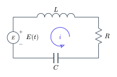</p>

*Circuito RLC em série alimentado por $`E (t)`$.*

> [!IMPORTANT]
> **Lei de Kirchhoff**
>
> ```math
> V = V_{L} + V_{R} + V_{C}
> ```
>
> (a soma das tensões no laço é zero / se conserva).

- **Capacitor:** $`Q = C V`$ (tensão). Como $`i = \frac{\mathrm{d} Q}{\mathrm{d} t}`$, temos $`\mathrm{d} V = \frac{i \mathrm{d} t}{C}`$, logo

   ```math
   i = C \frac{\mathrm{d} V}{\mathrm{d} t} \quad \text{(corrente)}
   ```

- **Indutor:** $`\phi = L i`$ (corrente). Como $`V = \frac{\mathrm{d} \phi}{\mathrm{d} t}`$ (lei de Faraday),

   ```math
   V = L \frac{\mathrm{d} i}{\mathrm{d} t} \quad \text{(tensão)}
   ```

Resumo: $`Q = C V`$, $`\phi = L i`$. Para outras relações, basta derivar.

## 6. Sistemas de EDOs de 1ª ordem

### 6.1. O que são?

```math
\begin{cases} x'_{1} = a_{11} (t) x_{1} + a_{12} (t) x_{2} + \cdots + a_{1 n} (t) x_{n} + g_{1} (t) \\ \vdots \\ x'_{n} = a_{n 1} (t) x_{1} + a_{n 2} (t) x_{2} + \cdots + a_{n n} (t) x_{n} + g_{n} (t) \end{cases}
```

onde $`a_{i j} (t)`$ e $`g_{i} (t)`$ são contínuas em um intervalo $`J \subset \mathbb{R}`$. Na forma matricial:

```math
\begin{pmatrix} x'_{1} (t) \\ \vdots \\ x'_{n} (t) \end{pmatrix} = \begin{pmatrix} a_{11} (t) & \cdots & a_{1 n} (t) \\ \vdots & \ddots & \vdots \\ a_{n 1} (t) & \cdots & a_{n n} (t) \end{pmatrix} \begin{pmatrix} x_{1} (t) \\ \vdots \\ x_{n} (t) \end{pmatrix} + \begin{pmatrix} g_{1} (t) \\ \vdots \\ g_{n} (t) \end{pmatrix}
```

> [!NOTE]
> **Forma matricial**
>
> ```math
> X' (t) = A (t) X (t) + g (t)
> ```

> [!IMPORTANT]
> **T.E.U.**
>
> Se $`a_{i j} (t)`$ e $`g_{i} (t)`$ são contínuas num intervalo $`J \subset \mathbb{R}`$, então, dados $`t_{0} \in J`$ e $`X_{0} \in \mathbb{R}^{n}`$, existe uma **única solução** $`X (t)`$, definida em $`J`$, do PVI:
>
> ```math
> X' (t) = A (t) X (t) + g (t) , \quad X (t_{0}) = X_{0} = \begin{pmatrix} x_{0}^{1} \\ \vdots \\ x_{0}^{n} \end{pmatrix}
> ```

- **Sistema homogêneo:** $`X' = A X`$
- **Sistema não homogêneo:** $`X' = A X + g (t)`$

> [!NOTE]
> **Matriz solução**
>
> $`X (t)_{n \times n}`$ é matriz solução do sistema $`X' = A (t) X`$ se cada coluna de $`X (t)`$ for uma solução desse sistema.

> [!TIP]
> **Exemplo**
>
> ```math
> X (t) = \begin{pmatrix} e^{t} & 0 \\ 0 & e^{2 t} \end{pmatrix}
> ```
>
>  é solução de $`X' = \begin{pmatrix} 1 & 0 \\ 0 & 2 \end{pmatrix} X`$. Derivando a 1ª coluna:
>
> ```math
> X'_{1} (t) = \begin{pmatrix} e^{t} \\ 0 \end{pmatrix} = \begin{pmatrix} 1 & 0 \\ 0 & 2 \end{pmatrix} \underbrace{\begin{pmatrix} e^{t} \\ 0 \end{pmatrix}}_{X_{1} (t)}
> ```
>
> (e o mesmo para $`X_{2}`$).
>
> Obs.: chamando as colunas de $`X (t)`$ de $`X_{i} (t)`$, dizemos, por exemplo, que $`X'_{i} (t) = A X_{i} (t)`$.

> [!NOTE]
> **Matriz fundamental**
>
> Matriz solução com $`\det X (t) \neq 0 \ \forall t \in J`$ (colunas L.I.).

> [!IMPORTANT]
> **Solução geral**
>
> Se $`X (t)`$ é matriz fundamental de $`X' = A (t) X`$, então a solução geral é dada por
>
> ```math
> X (t) = X (t) C , \quad C = \begin{pmatrix} c_{1} \\ \vdots \\ c_{n} \end{pmatrix} \in \mathbb{R}^{n} \text{(vetor constante)}
> ```

> [!IMPORTANT]
> **Fórmula de Jacobi-Liouville**
>
> ```math
> \det X (t) = \det X (t_{0}) e^{\int_{t_{0}}^{t} \text{tr} (A (s)) \mathrm{d} s}
> ```
>
> ($`t_{0} = 0`$, por exemplo), onde $`\text{tr} (A (s))`$ é o traço de $`A (s)`$ (soma dos elementos da diagonal principal).
>
> Serve para verificar se é a matriz fundamental: é o teorema de Abel melhorado.

### 6.2. Solucionando sistemas $`X' = A X`$ (homogêneos)

Basta achar autovalores/autovetores de

```math
(A - \lambda I) \vec{v} = \vec{0} \quad \rightarrow \quad \det (A - \lambda I) = 0
```

(descobrir os autovalores pelo **polinômio característico**). Para achar os autovetores, basta substituir $`\lambda`$ em $`(A - \lambda I) \vec{v} = \vec{0}`$.

> [!NOTE]
> **Matriz fundamental**
>
> ```math
> X (t) = (e^{\lambda_{1} t} v_{1} , \ldots , e^{\lambda_{n} t} v_{n}) \quad \rightarrow \quad X_{H} (t) = X (t) \vec{C}
> ```
>
> ($`\vec{C}`$: vetor de constantes).

#### Autovalores complexos de $`A`$

Com $`\lambda = \alpha + i \beta`$ e $`v = v_{1} + i v_{2}`$:

```math
\begin{aligned} e^{\lambda t} v & = e^{(\alpha + i \beta) t} (v_{1} + i v_{2}) = e^{\alpha t} (\cos (\beta t) + i \sin (\beta t)) (v_{1} + i v_{2}) \\ & = \underbrace{e^{\alpha t} (v_{1} \cos (\beta t) - v_{2} \sin (\beta t))}_{X_{1} = \text{Re} (X (t)) \text{ (solução 1)}} + i \underbrace{e^{\alpha t} (v_{1} \sin (\beta t) + v_{2} \cos (\beta t))}_{X_{2} = \text{Im} (X (t)) \text{ (solução 2)}} \end{aligned}
```

Obs.: sim, tem que achar os autovetores depois.

#### Autovalores repetidos

- $`m_{a} (\lambda)`$: grau de $`\lambda`$ no $`p (\lambda)`$ (multiplicidade algébrica).
- $`m_{g} (\lambda)`$: nº de autovetores L.I. que $`\lambda`$ gera (multiplicidade geométrica).

Casos:

- $`m_{g} (\lambda) = m_{a} (\lambda) \rightarrow \lambda`$ gera exatamente $`m_{a} (\lambda)`$ autovetores L.I.
- $`m_{g} (\lambda) < m_{a} (\lambda) \rightarrow \lambda`$ gera $`m_{g} (\lambda)`$ autovetores L.I., mas precisamos de $`m_{a} (\lambda)`$. Temos que buscar os autovetores restantes:

```math
\begin{aligned} (A - \lambda I) \vec{v}_{1} & = \vec{0} \\ (A - \lambda I) \vec{v}_{2} & = \vec{v}_{1} \\ (A - \lambda I) \vec{v}_{3} & = \vec{v}_{2} \\ & \vdots \\ (A - \lambda I) \vec{v}_{n} & = \vec{v}_{n - 1} \end{aligned}
```

```math
\begin{aligned} X_{1} (t) & = e^{\lambda t} v_{1} \\ X_{2} (t) & = e^{\lambda t} (v_{1} t + v_{2}) \\ X_{3} (t) & = e^{\lambda t} \left( v_{1} \frac{t^{2}}{2} ! + v_{2} t + v_{3} \right) \\ & \vdots \\ X_{n} (t) & = e^{\lambda t} \sum_{i = 1}^{n} \frac{t^{n - i}}{(n - i) !} v_{i} \end{aligned}
```

### 6.3. Sistemas lineares não homogêneos

```math
X' = A (t) X + f (t)
```

```math
X (t) = \underbrace{X (t) C}_{\text{matriz fundamental de} X' = A (t) X} + \underbrace{X_{p} (t)}_{\text{solução particular}}
```

> [!IMPORTANT]
> **Variação dos parâmetros**
>
> ```math
> X_{p} (t) = X (t) \int X^{- 1} (t) f (t) \mathrm{d} t
> ```
>
> ($`\int`$ = integral elemento a elemento; $`X (t)`$ é a matriz fundamental obtida do homogêneo).

> [!NOTE]
> **Adicional: inversa 2×2**
>
> Se $`M = \begin{pmatrix} a & b \\ c & d \end{pmatrix}`$ e $`\det M = a d - b c \neq 0`$, então
>
> ```math
> M^{- 1} = \frac{1}{\det M} \begin{pmatrix} d & - b \\ - c & a \end{pmatrix}
> ```
>
> (diagonal principal troca, diagonal secundária nega).

### 6.4. EDO de ordem $`k \ge 2`$ como sistema

Podemos transformar uma EDO de ordem $`n \ge 2`$ em um sistema de $`n`$ equações diferenciais de 1ª ordem.

> [!TIP]
> **Exemplo**
>
> $`y^{(5)} - 2 y^{(4)} + 4 y''' - 6 y'' + 7 y' = 0`$ (escrito com $`y_{0} = y`$):
>
> ```math
> \begin{cases} y'_{0} = y_{1} \\ y'_{1} = y_{2} \\ y'_{2} = y_{3} \\ y'_{3} = y_{4} \\ y'_{4} - 2 y_{3} + 4 y_{2} - 6 y_{1} + 7 y_{0} = 0 \end{cases}
> ```
>
> ```math
> \underbrace{\begin{pmatrix} y'_{0} \\ y'_{1} \\ y'_{2} \\ y'_{3} \\ y'_{4} \end{pmatrix}}_{Y'} = \underbrace{\begin{pmatrix} 0 & 1 & 0 & 0 & 0 \\ 0 & 0 & 1 & 0 & 0 \\ 0 & 0 & 0 & 1 & 0 \\ 0 & 0 & 0 & 0 & 1 \\ - 7 & 6 & - 4 & 2 & 0 \end{pmatrix}}_{A (t)} \underbrace{\begin{pmatrix} y_{0} \\ y_{1} \\ y_{2} \\ y_{3} \\ y_{4} \end{pmatrix}}_{Y}
> ```

## 7. Transformada de Laplace

> [!NOTE]
> **Definição**
>
> ```math
> \mathcal{L} \{f (t)\} = F (s) = \int_{0}^{+ \infty} e^{- s t} f (t) \mathrm{d} t
> ```
>
> (com $`f (t)`$ definida para $`t \ge 0`$ e a integral convergindo). $`F`$ é a transformada da função $`f`$.

Usamos a transformada para trocar uma **equação diferencial** $`f (y^{(n)} , \ldots , y , t) = 0`$ por uma **equação algébrica** $`f (s) = 0`$ em um domínio diferente. Ao manipular $`f (s) = 0`$ e aplicar a transformada inversa, temos a resposta $`y (t)`$.

<p align="center">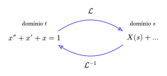</p>

*A transformada leva o problema ao domínio $`s`$; a inversa traz de volta.*

### 7.1. Transformadas básicas

| $`\mathcal{L} \{1\} = \frac{1}{s} , \quad s > 0`$ | $`\mathcal{L} \{e^{k t}\} = \frac{1}{s - k} , \quad s > k`$ |
|---|---|
| $`\mathcal{L} \{t^{n}\} = \frac{n !}{s^{n + 1}} , \quad s > 0`$ | $`\mathcal{L} \{\sin (k t)\} = \frac{k}{s^{2} + k^{2}} , \quad s > 0`$ |
|  | $`\mathcal{L} \{\cos (k t)\} = \frac{s}{s^{2} + k^{2}} , \quad s > 0`$ |

### 7.2. Condição para convergência

> [!NOTE]
> **Ordem exponencial**
>
> $`f`$ é de ordem exponencial se $`\exists c \in \mathbb{R} , M > 0 , T \ge 0`$ tais que
>
> ```math
> | f (t) | \le M e^{c t} \quad \forall t \ge T
> ```
>
> (conseguimos limitar a função por uma exponencial). Ex.: $`f (t) = t`$, $`f (t) = \sin (t)`$.

> [!NOTE]
> **Contínua por partes**
>
> Uma função é contínua por partes em $`I \subset \mathbb{R}`$ se, em qualquer subintervalo de $`I`$, há apenas um número finito de descontinuidades e toda descontinuidade é de **primeira espécie** (existem os limites laterais e eles tendem a um número).
>
> (2ª espécie: um dos lados vai para $`\pm \infty`$.)

Se $`f (t)`$ é de ordem exponencial e contínua por partes, ela converge em Laplace.

### 7.3. Propriedades

> [!IMPORTANT]
> **Teorema (Laplace é linear)**
>
> ```math
> \mathcal{L} \{\alpha f (t) + \beta g (t)\} = \alpha \mathcal{L} \{f (t)\} + \beta \mathcal{L} \{g (t)\}
> ```

> [!IMPORTANT]
> **Teorema (deslocamento de domínio)**
>
> ```math
> \mathcal{L} \{e^{c t} f (t)\} = F (s - c) \quad (s > a + c)
> ```

> [!IMPORTANT]
> **Teorema ($`t^{n} f (t)`$)**
>
> ```math
> \mathcal{L} \{t^{n} f (t)\} = (- 1)^{n} F^{(n)} (s)
> ```
>
> onde $`F^{(n)} (s)`$ é a derivada $`{\displaystyle \frac{\mathrm{d}^{n}}{\mathrm{d} s^{n}}}`$ de $`\mathcal{L} \{f (t)\}`$.

> [!IMPORTANT]
> **Fórmula da derivada**
>
> Sejam $`f , f' , \ldots , f^{(n - 1)}`$ contínuas e $`f^{(n)}`$ contínua por partes em $`[0 , A]`$. Então
>
> ```math
> \mathcal{L} \{f^{(n)} (t)\} = s^{n} \mathcal{L} \{f (t)\} - \sum_{i = 1}^{n} s^{n - i} f^{(i - 1)} (0)
> ```
>
> Os expoentes de $`s`$ vão de $`s^{n - 1}`$ a $`s^{0}`$ e as derivadas de $`f^{(0)} (0) = f (0)`$ a $`f^{(n - 1)} (0)`$ (contrários).
>
> Obs.: lembre-se de aplicar no ponto zero.

> [!IMPORTANT]
> **Fórmula da derivada inversa**
>
> ```math
> \mathcal{L}^{- 1} \left\{ \frac{\mathrm{d}}{\mathrm{d} s} F (s) \right\} = - t f (t)
> ```

### 7.4. Transformada inversa

Consiste em voltar: $`\mathcal{L}^{- 1} \{F (s)\}`$. Buscar funções elementares no domínio de $`s`$ (seja manipulando ou fazendo frações parciais).

> [!IMPORTANT]
> **Teorema (existência da inversa)**
>
> Se $`f (t)`$ for contínua por partes em $`[0 , \infty )]`$ e de ordem exponencial para $`t \ge T`$, então:
>
> ```math
> \lim_{s \to \infty} \mathcal{L} \{f (t)\} = \lim_{s \to \infty} F (s) = 0
> ```
>
> No infinito, $`F (s)`$ tem que dar zero.

### 7.5. Função degrau unitário

Permite modelar mudanças bruscas, descontinuidades e forças que ligam/desligam em sistemas dinâmicos descritos por EDOs. Funciona como um "interruptor": $`U (t - a)`$ liga quando $`t = a`$ e permanece em $`t > a`$.

> [!NOTE]
> **Degrau unitário**
>
> Para $`a > 0`$:
>
> ```math
> U (t - a) = \begin{cases} 0 , \quad 0 \le t < a \quad \text{(desligado)} \\ 1 , \quad t \ge a \quad \text{(ligado)} \end{cases}
> ```

> [!IMPORTANT]
> **Transformada do degrau**
>
> ```math
> \mathcal{L} \{f (t - a) U (t - a)\} = e^{- a s} F (s) , \quad a > 0
> ```
>
> onde $`F (s) = \mathcal{L} \{f (t)\}`$.

### 7.6. Função delta de Dirac

Permite modelar **forças impulsivas**, que aplicam uma intensidade imensa em um intervalo de tempo praticamente instantâneo. "Impacto".

<p align="center">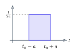</p>

> [!NOTE]
> **Pulso $`\delta_{a}`$**
>
> ```math
> \delta_{a} (t - t_{0}) = \begin{cases} 0 , \quad 0 \le t < t_{0} - a \\ \frac{1}{2 a} , \quad t_{0} - a \le t < t_{0} + a \\ 0 , \quad t \ge t_{0} + a \end{cases} \quad a > 0 , \ t_{0} > 0
> ```

```math
\int_{0}^{+ \infty} \delta_{a} (t - t_{0}) \mathrm{d} t = 1 , \quad \lim_{a \to 0} \delta_{a} (t - t_{0}) = 0 , \quad \lim_{a \to 0} \int_{0}^{+ \infty} \delta_{a} (t - t_{0}) \mathrm{d} t = 1
```

Vamos definir uma função impulso unitária que funciona como impulso de tamanho 1 em $`t = t_{0}`$:

> [!NOTE]
> **Delta de Dirac**
>
> 1. $`\delta (t - t_{0}) = 0`$ se $`t \neq t_{0}`$
> 1. $`{\displaystyle \int_{0}^{+ \infty} \delta (t - t_{0}) \mathrm{d} t = 1}`$
>
> ```math
> \mathcal{L} \{\delta (t - t_{0})\} = \lim_{a \to 0} \mathcal{L} \{\delta_{a} (t - t_{0})\} = e^{- s t_{0}}
> ```

### 7.7. Convolução (importante)

> [!NOTE]
> **Convolução**
>
> ```math
> (f \ast g) (t) = \int_{0}^{t} f (\tau) g (t - \tau) \mathrm{d} \tau \quad \left( = \int_{0}^{t} f (t - \tau) g (\tau) \mathrm{d} \tau \right)
> ```

> [!IMPORTANT]
> **Teorema da convolução**
>
> Sejam $`f , g`$ contínuas por partes em $`[0 , + \infty )]`$:
>
> ```math
> \mathcal{L} \{(f \ast g) (t)\} = F (s) \cdot G (s)
> ```
>
> ```math
> (f \ast g) (t) = \mathcal{L}^{- 1} \{F (s) \cdot G (s)\}
> ```
>
> Permite separar funções na transformada inversa!

> [!TIP]
> **Exemplo**
>
> ```math
> \begin{cases} y'' - 6 y' + 9 y = t^{2} e^{3 t} \\ y (0) = 2 \\ y' (0) = 6 \end{cases}
> ```
>
> Aplicando $`\mathcal{L}`$ dos dois lados e a fórmula da derivada (com $`Y = \mathcal{L} \{y\}`$):
>
> ```math
> [s^{2} Y - s y (0) - y' (0)] - 6 [s Y - y (0)] + 9 Y = \underbrace{\frac{2 !}{(s - 3)^{3}}}_{\text{deslocamento de domínio}}
> ```
>
> Organizando:
>
> ```math
> Y (s) = \frac{2}{(s - 3)^{5}} + \frac{2}{s - 3}
> ```
>
> Aplicando $`\mathcal{L}^{- 1}`$: $`{\displaystyle \frac{2}{(s - 3)^{5}} \to \frac{1}{12} e^{3 t} t^{4}}`$ ($`t^{n}`$ com domínio deslocado em $`a = 3`$) e $`{\displaystyle \frac{2}{s - 3} \to 2 e^{3 t}}`$:
>
> ```math
> y (t) = \frac{t^{4} e^{3 t}}{12} + 2 e^{3 t}
> ```
>
> Sempre que tiver termo elevado a alta potência, vai ser um $`t^{n}`$.

## 8. Anotações da Lista

### 8.1. Como resolver $`\sin () \cos ()`$?

Não resolve: separa.

> [!NOTE]
> **Produto de senos e cossenos**
>
> ```math
> \sin (2 t) = 2 \sin (t) \cos (t)
> ```
>
> ```math
> \sin (A) \cos (B) = \frac{1}{2} (\sin (A - B) + \sin (A + B))
> ```
>
> ```math
> \cos (A) \cos (B) = \frac{1}{2} (\cos (A - B) + \cos (A + B))
> ```
>
> ```math
> \sin (A) \sin (B) = \frac{1}{2} (\cos (A - B) - \cos (A + B))
> ```

### 8.2. Transformadas em cadeia

```math
t e^{a t} \sin (b t) = F (s - a) , \quad F = \mathcal{L} \left\{ t \underbrace{\sin (b t)}_{G} \right\} = (- 1)^{1} G' (s)
```

```math
= \frac{2 (s - a) b}{((s - a)^{2} + b^{2})^{2}}
```

### 8.3. Interruptor ($`U`$)

```math
f (t) = \begin{cases} t , \quad 0 \le t < 1 \\ 1 , \quad t \ge 1 \end{cases} \quad \rightarrow \quad f (t) = t \underbrace{(1 - U (t - 1))}_{\left[ 0 , 1 ) ) + 1 \cdot \underbrace{U (t - 1)}_{[1 , \infty ) )]} \right]}
```

```math
\begin{aligned} f (t) & = t - t U (t - 1) + U (t - 1) \quad \text{(precisamos de} (t - 1) \text{)} \\ & = t - (t - 1 + 1) U (t - 1) + U (t - 1) \end{aligned}
```

Obs.: se $`f (t) = 2`$, então $`f (t - a) = 2`$ (constante).

### 8.4. Periodicidade

```math
\mathcal{L} \{\sin (t) U (t - 2 \pi)\} = \mathcal{L} \{\sin (t - 2 \pi) U (t - 2 \pi)\}
```

```math
\begin{aligned} \cos (2 t) + \cos (2 t) U (t - \pi) & = \cos (2 t) + \cos (2 t + 2 \pi - 2 \pi) U (t - \pi) \\ & = \cos (2 t) + \cos (2 (t - \pi)) U (t - \pi) \quad \overset{\mathcal{L}}{\rightarrow} \quad \ldots + e^{- \pi s} \frac{s}{s^{2} + 4} \end{aligned}
```

### 8.5. Outras anotações

- **Se tem potência, é $`t^{n}`$:** $`{\displaystyle \frac{4}{(s - 1)^{3}} \quad \overset{\mathcal{L}^{- 1}}{\rightarrow} \quad 2 e^{t} t^{2}}`$
- **Convolução vale propriedade associativa:** $`\mathcal{L} \{f \ast g \ast h\} = F \cdot G \cdot H`$
- **Convolução é comutativa:** $`f \ast g = g \ast f`$
- **Como saber se a transformada é válida?** $`{\displaystyle \lim_{s \to \infty} F (s) = 0}`$
- **Função periódica:** $`f (t) = f (t + T) = f (t + 2 T)`$
- **Regra da derivada:** $`s^{n} Y - s^{n - 1} y (0) - \ldots`$ (começa do zero e continua caindo).
- **Função delta:** $`\delta (t - a) \overset{\mathcal{L}}{\rightarrow} e^{- a s}`$

#### Frações parciais

- **Termos simples:** $`{\displaystyle (x - 1) (x + 2) \rightarrow \frac{A}{x - 1} + \frac{B}{x + 2}}`$
- **Termo 1 elevado:** $`{\displaystyle (x - 1)^{2} \rightarrow \frac{A}{x - 1} + \frac{B}{(x - 1)^{2}}}`$
- **Termo 2 elevado sem raízes reais:** $`{\displaystyle (x^{2} + 4) \rightarrow \frac{A x + B}{x^{2} + 4}}`$

Obs.:

```math
P \frac{s}{(s^{2} + 2)^{2}} = \frac{A s + B}{s^{2} + 2} + \frac{C s + D}{(s^{2} + 2)^{2}}
```

> [!TIP]
> **Exemplo**
>
> **Achar frações parciais por substituição** (bem mais fácil!):
>
> ```math
> \frac{s + 1}{(s - 1) (s + 2)} = \frac{A}{s - 1} + \frac{B}{s + 2}
> ```
>
> ```math
> s + 1 = A (s + 2) + B (s - 1)
> ```
>
> - $`s = 1`$: $`2 = 3 A \rightarrow A = \frac{2}{3}`$
> - $`s = - 2`$: $`- 1 = - 3 B \rightarrow B = \frac{1}{3}`$

# Estatística (SME0123)

## 1. Probabilidade básica

> [!NOTE]
> **União de eventos**
>
> ```math
> P (A \cup B) = P (A) + P (B) - P (A \cap B)
> ```

> [!NOTE]
> **Mutuamente Exclusivo**
>
> A, B mutuamente exclusivos:
>
> ```math
> P (A \cap B) = 0
> ```

> [!NOTE]
> **Probabilidade condicional**
>
> Probabilidade de A dado que ocorreu B:
>
> ```math
> P (A | B) = P \frac{A \cap B}{P} (B) \Leftrightarrow P (A \cap B) = P (A | B) P (B)
> ```

> [!NOTE]
> **Independência**
>
> ```math
> P (A | B) = P (A) \rightarrow P (A \cap B) = P (A) P (B)
> ```

> [!IMPORTANT]
> **AND/OR**
>
> ```math
> P (A \text{ e } b) \rightarrow P (A \cap B)
> ```
>
> ```math
> P (A \text{ ou } b) \rightarrow P (A \cup B)
> ```

> [!IMPORTANT]
> **Espaço amostral**
>
> Se há apenas A, B e C em $`\Omega`$, então:
>
> ```math
> P (A) + P (B) + P (C) = 1
> ```

> [!IMPORTANT]
> **Probabilidade total**
>
> ```math
> P (A) = P (A \cap B) + P (A \cap \overline{B})
> ```
>
> ```math
> P (A) = P (A | B) P (B) + P (A | \overline{B}) P (\overline{B})
> ```
>
> ```math
> P (A) = P (A \cap B \cap C) + P (A \cap \overline{B} \cap C) + P (A \cap B \cap \overline{C}) + P (A \cap \overline{B} \cap \overline{C})
> ```

> [!IMPORTANT]
> **Complemento**
>
> ```math
> P (A) = 1 - P (\overline{A})
> ```
>
> ```math
> P (\overline{A} | B) = 1 - P (A | B)
> ```

> [!IMPORTANT]
> **Bayes (Troca)**
>
> Se $`\cup_{k = 0}^{N} A_{i} = \Omega`$, então:
>
> ```math
> P (A_{i} | B) = \frac{P (B | A_{i}) P (A_{i})}{\sum P (B | A_{i}) P (A_{i})}
> ```
>
> (São intersecções: $`P (A_{i} \cap B)`$

O segredo para trabalhar com exercícios de probabilidade é, primeiro, extrair $`P (A)`$, $`P (A | B)`$, $`P (A \cap B)`$, montar as proposições, e trabalhar com as propriedades.

## 2. Funções de probabilidade

> [!NOTE]
> **Variável aleatória**
>
> Variável aleatória é uma função $`X (\omega)`$ que associa a cada elemento $`\omega \in \Omega`$ um número real $`x = x (\omega)`$.
>
> ```math
> \Omega = \{S , S , S , N , N\} \rightarrow X (\omega) = \{1 , 1 , 1 , 0 , 0\}
> ```
>
> Ela pode ser discreta ou contínua (tempo de vida de objeto, em horas).
>
> > **Exemplo.**
> >
> > Ex: Duas pessoas jogam 3 moedas cada. Qual a probabilidade de obter o mesmo número de caras? (k)
> >
> > ```math
> > X (\Omega) = \begin{cases} k = 0 \rightarrow 1 \text{ poss.} \rightarrow k = \frac{1}{8} \\ k = 1 \rightarrow 3 \text{ poss.} \rightarrow k = \frac{3}{8} \\ k = 2 \rightarrow 3 \text{ poss.} \rightarrow k = \frac{3}{8} \\ k = 3 \rightarrow 1 \text{ poss.} \rightarrow k = \frac{1}{8} \end{cases}
> > ```
> >
> > Total: 8 possibilidades
> >
> > ```math
> > \begin{gathered} P (A = B) = P (k_{a} = 0 \cap k_{b} = 0) + P (k_{a} = 1 \cap k_{b} = 1) + \\ + P (k_{a} = 2 \cap k_{b} = 2) + P (k_{a} = 3 \cap k_{b} = 3) \end{gathered}
> > ```
> >
> > A e B são independentes, logo: $`P (A \cap B) = P (A) P (B)`$
> >
> > ```math
> > P (A = B) = \overset{2}{\left( \frac{1}{8} \right)} + \overset{2}{\left( \frac{3}{8} \right)} + \overset{2}{\left( \frac{3}{8} \right)} + \overset{2}{\left( \frac{1}{8} \right)}
> > ```

> [!NOTE]
> **Função massa de probabilidade ou f.m.p. (discreta)**
>
> Associa a cada variável aleatória discreta um valor.
>
> ```math
> p_{x} (x_{i}) = P (X (w_{i}))
> ```
>
> Deve satisfazer:
>
> 1. $`p_{x} (x_{i}) > 0`$ para todo $`x_{i}`$
> 1. $`\sum p_{x} (x_{i}) = 1`$

> [!NOTE]
> **Função densidade de probabilidade ou f.d.p. (contínua)**
>
> Associa a cada variável aleatória um valor.
>
> ```math
> f_{x} (x_{i}) = P (X (w_{i}))
> ```
>
> Deve satisfazer:
>
> 1. $`f_{x} (x) \ge 0`$ para todo $`x \in R_{x}`$
> 1. $`\int_{- \infty}^{+ \infty} f_{x} (x) d x = 1`$
> 1. $`P (a < X < b) = \int_{a}^{b} f_{x} (x) d x`$
>
> Propriedades:
>
> - $`P (x > a) = P (x \ge a) = \int_{a}^{+ \infty} f_{x} (x) d x`$
> - $`P (x \ge a) = 1 - P (X < a)`$

> [!NOTE]
> **Função distribuição acumulada**
>
> Caso discreto:
>
> ```math
> F_{x} (x) = P (X \le x) = \sum_{x_{i} \le x} p_{x} (x_{i})
> ```
>
> Caso contínuo (é a primitiva):
>
> ```math
> F_{x} (x) = P (X \le x) = \int_{- \infty}^{x} f_{x} (t) d t
> ```
>
> Consequência imediata:
>
> ```math
> P (a < X < b) = \int_{a}^{b} f_{x} (x) d x = F_{x} (b) - F_{x} (a)
> ```

> [!NOTE]
> **Esperança Matemática/Valor médio**
>
> Seja $`X`$ uma variável aleatória. No caso discreto:
>
> ```math
> \mu = E (X) = \sum x p_{x} (x)
> ```
>
> ($`p_{x} (x)`$ virá das distribuições). Caso contínuo:
>
> ```math
> \mu = E (X) = \int_{- \infty}^{+ \infty} x f_{x} (x) d x
> ```
>
> Propriedades:
>
> 1. Se $`X = a`$ (constante), então $`E (X) = E (a) = a`$
> 1. $`E (E (X)) = E (X)`$
> 1. $`E (a X \pm b Y) = a E (X) \pm b E (Y)`$

> [!NOTE]
> **Variância**
>
> ```math
> \begin{gathered} \sigma^{2} = \text{Var} (X) = E ((X - E (X))^{2}) \\ \sigma^{2} = E (X^{2}) - [E (X)]^{2} \end{gathered}
> ```
>
> Obs: $`E (X^{2}) = \sum x^{2} p_{x} (x) \text{ ou } \int_{- \infty}^{+ \infty} x^{2} f_{x} (x) d x`$
>
> Propriedades:
> 1. Se $`X = a`$ (constante), então $`\text{Var} (X) = \text{Var} (a) = 0`$
> 1. $`\text{Var} (X \pm a) = \text{Var} (X)`$
> 1. Se X e Y são independentes: $`\text{Var} (a X \pm b Y) = a^{2} \text{Var} (X) + b^{2} \text{Var} (Y)`$
>
> A raiz quadrada da variância é o desvio padrão.

## 3. Distribuições

### 3.1. Distribuições Discretas

> [!NOTE]
> **Distr. Uniforme Discreta**
>
> A variável X assume cada um de seus valores com igual probabilidade.
>
> ```math
> p_{x} (x) = \begin{cases} \frac{1}{k} \text{, } x \in \{x_{1} , \ldots , x_{k}\} \\ 0 \text{, caso contrário} \end{cases}
> ```
>
> Notação: $`X \sim U_{d} (k)`$

> [!NOTE]
> **Distr. de Bernoulli**
>
> A variável X assume apenas dois valores:
>
> ```math
> \begin{cases} 1 \text{, se sucesso} \\ 0 \text{, se fracasso} \end{cases}
> ```
>
> ```math
> p_{x} (x) = \begin{cases} p^{x} (1 - p)^{1 - x} \text{, } x \in \{0 , 1\} \\ 0 \text{, caso contrário} \end{cases}
> ```
>
> Notação: $`X \sim B e r (p)`$
>
> ```math
> \mu = p
> ```
>
> ```math
> \sigma^{2} = p (1 - p)
> ```

> [!NOTE]
> **Distr. Binominal**
>
> Considere **M eventos de Bernoulli independentes**, todos com a **mesma probabilidade de sucesso $`p`$**.
>
> ```math
> p_{x} (x) = \begin{cases} \binom{M}{x} p^{x} (1 - p)^{M - x} \text{, } x \in \{0 , 1 , \ldots , M ) , 0 \text{, caso contrário} )\} \end{cases}
> ```
>
> (Obs: diferente de Bernoulli, usa-se $`x \in \{0 , 1 , \ldots , M\}`$ na potência!)
>
> Notação: $`X \sim B i n (M , p)`$
>
> ```math
> \mu = M p
> ```
>
> ```math
> \sigma^{2} = M p (1 - p)
> ```
>
> > **Exemplo.**
> >
> > O fabricante indica que a taxa de equipamentos em perfeito estado é 97%.
> >
> > a) Seleciona-se ao acaso 20 destes itens. Qual a probabilidade de que haja **pelo menos um** item defeituoso nesses 20?
> >
> > 1. Probabilidade de ter defeito: $`1 - 0.97 = 0.03`$
> > 1. Pelo menos um: $`p_{x} (X \ge 1) = 1 - p (X = 0)`$
> > 1. $`p_{x} (0) = 1 - \binom{20}{0} (0.03)^{0} (1 - 0.03)^{20 - 0} = 1 - 0.54 = 0.46 = 46 \%`$
> >
> > b) Selecionando-se aleatoriamente 20 itens em cada um de 10 carregamentos, qual a probabilidade de que haja 3 carregamentos com pelo menos um item defeituoso?
> >
> > 1. Agora que temos a probabilidade de um único caregamento, **aplica-se distribuição binomial novamente com o novo $`p`$**.
> > 1. $`p_{x} (3) = \binom{10}{3} (0.46)^{3} (1 - 0.46)^{10 - 3} = 0.16 = 16 \%`$

> [!NOTE]
> **Distr. Geométrica**
>
> Considere uma sequência de eventos de Bernoulli independentes, todos com a **mesma probabilidade de sucesso $`p`$**. Seja a variável X o número de fracassos anteriores ao primeiro sucesso.
>
> ```math
> p_{x} (x) = \begin{cases} p (1 - p)^{x} \text{, } x \in \{0 , 1 , \ldots\} \\ 0 \text{, caso contrário} \end{cases}
> ```
>
> Notação: $`X \sim G e o (p)`$
>
> ```math
> \mu = \frac{1 - p}{p}
> ```
>
> ```math
> \sigma^{2} = \frac{1 - p}{p^{2}}
> ```
>
> > **Exemplo.**
> >
> > Um pesquisador está realizando experimentos químicos independentes e sabe que a probabilidade de que cada experimento apresente uma reação positiva é 0.3. Qual a probabilidade de que menos de 3 reações negativas ocorram antes da primeira positiva?
> >
> > 1. $`p_{x} (X \le 2) = \sum_{x = 0}^{2} 0.3 (1 - 0.3)^{x} = 0.66 = 66 \%`$

> [!NOTE]
> **Distr. Binomial Negativa**
>
> Considere eventos de Bernoulli independentes, todos com a mesma probabilidade de sucesso $`p`$. Seja a variável X como o número de fracassos anteirores ao r-ésimo sucesso.
>
> ```math
> p_{x} (x) = \begin{cases} \binom{x + r - 1}{r - 1} p^{r} (1 - p)^{x} \text{, } x \in \{0 , 1 , \ldots\} \\ 0 \text{, caso contrário} \end{cases}
> ```
>
> Notação: $`X \sim B N (r , p)`$
>
> ```math
> \mu = r \left( \frac{1 - p}{p} \right)
> ```
>
> ```math
> \sigma^{2} = r \left( \frac{1 - p}{p^{2}} \right)
> ```
>
> > **Exemplo.**
> >
> > Em uma série do campeonato, o time que ganhar 4 em 7 jogos será o vencedor. Se a probabilidade do time A ganhar de B é 55% e A e B se enfrentarão em uma série de 7 jogos, qual a probabilidade de que A vença a série em 6 jogos?
> >
> > 1. r-ésimo sucesso: 4
> > 1. Fracassos: 2 em 6 jogos.
> > 1. $`p_{x} (2) = \binom{2 + 4 - 1}{4 - 1} 0.55^{4} (1 - 0.55)^{2} = 0.18 = 18 \%`$

> [!NOTE]
> **Distr. Hipergeométrica**
>
> Considere um conjunto de $`n`$ objetos dos quais $`m`$ são do tipo I e $`n - m`$ são do tipo II (complementos). Para um sorteio de $`r < n`$ objetos, feito ao acaso e sem reposição, defina X como o número de objetos do tipo I selecionados.
>
> ```math
> p_{x} (x) = \frac{\binom{m}{x} \binom{n - m}{r - x}}{\binom{n}{r}}
> ```
>
> ```math
> \max \{0 , r - (n - m)\} \le x \le \min \{r , m\}
> ```
>
> Notação: $`x \sim H g e o (m , n , r)`$
>
> ```math
> \mu = r \frac{m}{n}
> ```
>
> ```math
> \sigma^{2} = \frac{r m (n - m) (n - r)}{n^{2} (n - 1)}
> ```
>
> > **Exemplo.**
> >
> > Considere que em um lote de 20 peças existam 4 defeituosas. Selecionando 5 dessas peças, sem reposição, qual a probabilidade de escolher 2 defeituosas?
> >
> > 1. $`m = 4 \rightarrow n = 16`$
> > 1. $`r = 5`$
> > 1. $`p_{x} (2) = \frac{\binom{4}{2} \binom{16 - 4}{5 - 2}}{\binom{16}{5}} = 0.3 = 30 \%`$

> [!NOTE]
> **Distr. Poisson**
>
> Muito usada quando se deseja contar o número de eventos de certo tipo que ocorrem em um certo período de tempo ou superfície/volume. Utiliza-se o parâmetro $`\lambda > 0`$ (média).
>
> ```math
> p_{x} (x) = \begin{cases} \frac{e^{- \lambda} \lambda^{x}}{x} ! \text{, } x \in \{0 , 1 , \ldots\} \\ 0 \text{, caso contrário} \end{cases}
> ```
>
> Notação: $`X \sim P o i (\lambda)`$
>
> ```math
> \mu = \lambda
> ```
>
> ```math
> \sigma^{2} = \lambda
> ```
>
> > **Exemplo.**
> >
> > Uma central telefônica recebe, em média, cinco chamadas p/min. Supondo que a distribuição Poisson seja adequada nessa situação, obtenha a probabilidade de que a central telefônica receba no máximo duas chamadas durante um intervalo de um minuto.
> > 1. $`\lambda = 5`$
> > 1. $`p_{x} (X \le 2) = \sum_{x = 0}^{2} \frac{e^{- 5} \cdot 5^{x}}{x} ! = 0.12 = 12 \%`$
>
> Obsevações
>
> 1. Se $`X_{1} , \ldots , X_{n}`$ são variáveis aleatórias indepentes e $`X_{i} \sim P o i (\lambda_{i})`$, então
>
>    ```math
>    Y = X_{1} + \ldots + X_{n} \sim P o i (\lambda_{1} + \ldots + \lambda_{n})
>    ```
>
> 1. Se $`X \sim B i n (M , p)`$, com $`M \gg p`$, pode-se aproximar para Poisson com $`\lambda = M p`$
> 1. $`E (x) = V a r (x) = \lambda`$

### 3.2. Distribuições Contínuas

> [!NOTE]
> **Distr. Uniforme**
>
> Uma variável aleatória contínua X tem distribuição uniforme no intervalo $`[\alpha , \beta] , a , b \in \mathbb{R}`$ se:
>
> ```math
> f_{x} (x) = \begin{cases} \frac{1}{\beta - \alpha} \text{, } \alpha \le x \le \beta \\ 0 \text{, caso contrário} \end{cases}
> ```
>
> Obs: Área = $`(\beta - \alpha) \cdot \frac{1}{\beta - \alpha} = 1`$
>
> Notação: $`X \sim U (\alpha , \beta)`$
>
> ```math
> \mu = \frac{\alpha + \beta}{2}
> ```
>
> ```math
> \sigma^{2} = \frac{(\beta - \alpha)^{2}}{12}
> ```

> [!NOTE]
> **Distr. Exponencial**
>
> Uma variável aleatória contínua X tem distribuição exponencial com parâmetro $`\lambda > 0`$ (média) se:
>
> ```math
> f_{x} (x) = \begin{cases} \frac{1}{\lambda} e^{- \frac{x}{\lambda}} \text{, } x \ge 0 \\ 0 \text{, caso contrário} \end{cases}
> ```
>
> Notação: $`X \sim E x p (\lambda)`$
>
> ```math
> \mu = \lambda
> ```
>
> ```math
> \sigma^{2} = \lambda^{2}
> ```

> [!NOTE]
> **Distr. Normal/Gaussiana**
>
> Uma variaǘel aleatória contínua X tem distribuição normal com $`\mu`$ (média) e $`\sigma^{2}`$ (variância) se:
>
> ```math
> f_{x} (x) = \frac{1}{\sqrt{2 \pi \sigma^{2}}} e^{- \frac{1}{2 \sigma^{2}} (x - \mu)^{2}}
> ```
>
> ```math
> - \infty < x < \infty
> ```
>
> Notação: $`X \sim N (\mu , \sigma^{2})`$
>
> Propriedades:
>
> 1. A distribuição é simétrica em relação à média. $`f_{x} (\mu - x) = f_{x} (\mu + x)`$.
> 1. A $`f . d . a`$ é uma integral sem solução analítica. Calculam-se as probabilidades com auxílio de tabela.
>
> > **Distr. Normal-padrão.**
> >
> > Se $`X \sim N (\mu , \sigma^{2})`$, então a variável aleatória Z;
> >
> > ```math
> > Z = \frac{X - E (X)}{\sqrt{V a r (X)}} = \frac{X - \mu}{\sigma}
> > ```
> >
> > Terá distribuição normal com **média 0 e variância 1**, $`Z = N (0 , 1)`$.
>
> > **Aprox. da binomial pela normal.**
> >
> > Se $`X \sim B i n (M , p)`$, sabe-se que:
> >
> > ```math
> > E (X) = \mu = M p
> > ```
> >
> > ```math
> > V a r (X) = \sigma^{2} = M p (1 - p)
> > ```
> >
> > Seja $`Y \sim N (\mu , \sigma^{2})`$, com os valores anteriores. Assim, aproxima-se a binomial pela normal.
> >
> > ```math
> > X \sim B i n (M , p) \approx N (\mu , \sigma^{2})
> > ```
> >
> > A aproximação é boa quando $`M p (1 - p) \ge 3`$.
>
> > **Teorema do limite central.**
> >
> > À medida que o tamanho da amostra (n) aumenta, a distribuição da média amostral aproxima-se de uma distribuição normal, independentemente da forma da distribuição original da população.
> >
> > - A média da distribuição amostral é igual à media da população original.
> > - O desvio padrão é dado por $`\frac{\sigma}{\sqrt{n}}`$
> >
> > > **Exemplo.**
> > >
> > > Amostra com n=25 de população com $`N (80 , 25)`$. ($`\sigma = 5`$)
> > >
> > > Amostra com n=36 de população com $`N (75 , 9)`$. ($`\sigma = 3`$)
> > >
> > > Qual a probabilidade da média amostral em n=25 exceder a média amostral em n=26 por no mínimo 3.4 mas no máximo 5.9.
> > >
> > > Média da diferença:
> > >
> > > ```math
> > > \mu_{\triangle} = 80 - 75 = 5
> > > ```
> > >
> > > Desvio da diferença (soma das variâncias):
> > >
> > > ```math
> > > \sigma_{\triangle}^{2} = \frac{\sigma_{1}^{2}}{n_{1}} + \frac{\sigma_{2}^{2}}{n_{2}} = 1.1
> > > ```
> > >
> > > Assim, a distribuição da diferença das médias é $`N (5 , 1.1)`$.

> [!NOTE]
> **Distribuição de Weibull**
>
> Uma variável aleatória X tem distribuição de Weibull se, para $`\lambda > 0`$ (média):
>
> ```math
> f_{x} (x , \alpha , \beta) = \begin{cases} \alpha \beta x^{\beta - 1} e^{- \alpha x^{\beta}} \text{, se } x \ge 0 \\ 0 \text{, caso contrário} \end{cases}
> ```
>
> Para $`\beta = 1`$, a distribuição se reduz à distribuição exponencial.
>
> ```math
> \mu = \alpha^{- \frac{1}{\beta}} \cdot \Gamma \left( 1 + \frac{1}{\beta} \right)
> ```
>
> ```math
> \sigma^{2} = \alpha^{- \frac{2}{\beta}} \left\{ \Gamma \left( 1 + \frac{2}{\beta} \right) - \overset{2}{\left[ \Gamma \left( 1 + \frac{1}{\beta} \right) \right]} \right\}
> ```
>
> Onde:
>
> ```math
> \Gamma (n) = \int_{0}^{\infty} t^{n - 1} e^{- t} d t
> ```
>
> ```math
> \Gamma (n) = (n - 1) ! , n \in \mathbb{N}^{\ast}
> ```
>
> Em particular:
>
> ```math
> \Gamma \left( \frac{3}{2} \right) = \frac{\sqrt{\pi}}{2}
> ```
>
> A função de confiabilidade (sobrevivência) é:
>
> ```math
> P (T > t) = e^{- \alpha x^{\beta}}
> ```

### 3.3. Notas adicionais

> [!IMPORTANT]
> **Expansão de termo na esperança**
>
> Se $`C (X) = (X + 5)^{2}`$ é o custo da função, então $`E (C (X)) = E (X^{2} + 10 X + 25) = E (X^{2}) + 10 E (X) + 25`$

> [!IMPORTANT]
> **Tabela de distribuição normal padrão**
>
> 1. A tabela fornece apenas áreas superiores ao ponto $`P (Z \ge z)`$. Assim, se queremos $`P (Z < 2)`$, devemos utilizar $`1 - P (Z \ge 2)`$.
> 1. Para usar a tabela, deve-se padronizar a variável aleatória X:
>
> ```math
> Z = \frac{X - \mu}{\sigma}
> ```

> [!IMPORTANT]
> **Z-score em Machine Learning**
>
> O Z score é útil para otimizar modelos de machine-learning.
>
> ```math
> Z = \frac{X - \mu}{\sigma}
> ```
>
> 1. Eliminação de diferenças de escala: Se uma featura varia entre 0 e 1 e outra entre 0 e 100.000, o gráfico de erro forma um "vale oval e comprimido". O algoritmo perde muito tempo até encontrar o mínimo. Com dados padronizados, as diferenças de escala somem, e o gráfico fica equilibrado (esférico), agilizando o GD. Isso impede que sinais de alta amplitude dominem o aprendizado do modelo.
> 1. Detecção de outliers: Valores com $`| Z | > 3`$ são anomalias que se desviam drasticamente da média da população original, e podem ser identificados.

> [!IMPORTANT]
> **Nota de exercício de distr. normal**
>
> Um protocolo de roteamento distribui pacotes de dados de modo que o tempo de latência siga uma distribuição Normal com desvio-padrão de 10 ms. O administrador precisa garantir que apenas 10% dos pacotes tenham latência inferior a 500 ms.
>
> Qual deve ser o tempo médio configurado no sistema?
>
> 1. $`\sigma = 10 \text{ms}`$
> 1. Na tabela, não se pode consultar simplesmente $`f_{x} (Z) = 0.1`$, pois a tabela dá $`f_{x} (X \ge 500)`$. Assim, temos que buscar$`f_{x} (X \le 500) = 1 - f_{x} (X \ge 500)`$:
>
> ```math
> 1 - f_{x} (Z) = 0.1 \rightarrow f_{x} (Z) = 0.9 \rightarrow Z = - 1.28
> ```
>
> 1. $`Z = \frac{X - \mu}{\sigma} \rightarrow - 1.28 = \frac{500 - \mu}{10} \rightarrow \mu = 512.8`$

> [!IMPORTANT]
> **Nota de exercício de distr. normal - Acúmulo de média/variância**
>
> Um servidor em nuvem suporta até 500 GB de memória RAM para instâncias virtuais. O consumo de cada instância é Normal, com média 70 GB e variância 100 GB².
>
> Qual é a probabilidade aproximada de 7 instâncias independentes ultrapassarem, em conjunto, o limite de 500 GB?
>
>    1. Nova média: $`7 \cdot 70 \text{GB} = 490 \text{GB}`$
>    1. Nova variância: $`7 \cdot 100 \text{GB}^{2} \rightarrow \sigma = \sqrt{700} = 26.48 \text{GB}`$
>    1. $`Z = \frac{500 - 490}{26.48} = 0.378`$
>    1. $`f_{x} (X \ge 500) = P (Z \ge 0.378) = 0.3527`$

## 4. Variáveis Aleatórias Bidimensionais

Sejam X e Y duas variáveis aleatórias. Quando há interesse na variação conjunta de X e Y, estudamos (X,Y) como uma variável aleatória bidimensional.

> [!NOTE]
> **Variável aleatória bidimensional discreta**
>
> A variável aleatória bidimensional discreta (X, Y) tem f.m.p. conjunta definida por:
>
> ```math
> p_{x , y} = P (X = x , Y = y)
> ```
>
> Ela é utilizada quando há interesse na variação conjunta de X e Y.
>
> Propriedades:
>
> 1. $`p_{x , y} (x , y) \ge 0`$
> 1. $`\sum_{x_{i}} \sum_{y_{i}} p_{x , y} (x_{i} , y_{i}) = 1`$
>
> > **Exemplo.**
> >
> > ```math
> > X = \begin{cases} 1 \text{, se a peça passa no 1 teste} \\ 0 \text{, se a peça falha no 1 teste} \end{cases}
> > ```
> >
> > ```math
> > Y = \begin{cases} 1 \text{, se a peça passa no 2 teste} \\ 0 \text{, se a peça falha no 2 teste} \end{cases}
> > ```
> >
> > | $`p_{x , y} (x , y)`$ | **Y** |
> > |---|---|---|
> > | X | 0 | 1 |
> > | 0 | 0.1 | 0.2 |
> > | 1 | 0.2 | 0.5 |

> [!NOTE]
> **Distribuições Marginais**
>
> Para uma variável aleatória bidimensional, a probabilidade marginal de X é dada por:
>
> ```math
> p_{x} (x) = \sum_{y_{i}} p_{x , y} (x , y)
> ```
>
> E a probabilidade marginal de y é:
>
> ```math
> p_{y} (y) = \sum_{x} p_{x , y} (x , y)
> ```

> [!NOTE]
> **Variável aleatória bidimensional contínua**
>
> A variável aleatória bidimensional contínua (X,Y) tem f.d.p. conjunta dada por $`f_{x , y} (x , y)`$ e f.d.a $`F_{x , y} (x , y) = P (X \le x , y \le y)`$, satisfazendo:
>
> 1. $`f_{x , y} (x , y) \ge 0`$
> 1. $`\int_{- \infty}^{\infty} \int_{- \infty}^{\infty} f_{x , y} (x , y) d y d x = \int_{- \infty}^{\infty} \int_{- \infty}^{\infty} f_{x , y} (x , y) d x d y = 1`$
> 1. $`F (x , y) (x , y) = P (X \le x , Y \le y) = P (X < x , Y \le y) = P (X \le x , Y < y) = P (X < x , Y < y)`$
>
> Propriedades:
>
> 1. $`f_{x , y} (x , y) = \frac{\partial^{2} F_{x , y} (x , y)}{\partial x \partial y} = \frac{\partial^{2} F_{x , y} (x , y)}{\partial y \partial x}`$
> 1. $`F_{x , y} (x , y) = \int_{- \infty}^{x} \int_{- \infty}^{y} f_{x , y} (t , w) d w d t`$
> 1. $`P (a \le X \le b , c \le Y \le d) = \int_{a}^{b} \int_{c}^{d} f_{x , y} (x , y) d y d x`$
>
> Todas as integral são invertíveis por Fubini.

> [!NOTE]
> **Densidades Marginais**
>
> Seja (X,Y) a variável aleatória contínua bidimensional com f.d.p. conjunta $`f_{x , y} (x , y)`$. A f.d.p. marginal de X é dada por:
>
> ```math
> f_{x} (x) = \int f_{x , y} d y
> ```
>
> E a f.d.p. marginal de Y é:
>
> ```math
> f_{y} (y) = \int f_{x , y} (x , y) d x
> ```

> [!NOTE]
> **Independência Probabilística**
>
> Duas variáveis aleatórias X e Y são independentes se a f.m.p. (ou f.d.p.) conjunta de (X,Y) for fatorável no produto das f.m.p. (ou f.d.p.) marginais de de X e Y:
>
> ```math
> p_{x , y} (x , y) = p_{x} (x) \cdot p_{y} (y)
> ```
>
> ```math
> f_{x , y} (x , y) = f_{x} (x) \cdot f_{y} (y)
> ```

> [!NOTE]
> **Esperança**
>
> ```math
> E (h (X , Y)) = \sum_{i} \sum_{i} h (x , y) p_{x , y} (x , y)
> ```
>
> Ou
>
> ```math
> E (h (X , Y)) = \int \int h (x , y) f_{x , y} d y d x
> ```

> [!NOTE]
> **Covariância**
>
> ```math
> \sigma_{X Y} = C o v (X , Y) = E ((X - \mu_{x}) (Y - \mu_{y})) = E (X Y) - E (X) E (Y) = E (X Y) - \mu_{x} \mu_{y}
> ```
>
> E a correlação entre X e Y por:
>
> ```math
> \rho_{x , y} = \frac{C o v (X , Y)}{\sqrt{V a r (X)} \sqrt{V a r (Y)}} = \frac{\sigma_{x y}}{\sigma_{x} \sigma_{y}}
> ```

> [!NOTE]
> **Independência e correlação**
>
> Se X e Y são duas variáveis aleatórias independentes, então a correlação entre X e Y é nula. A volta não vale.

> [!NOTE]
> **Variância de X e Y**
>
> Propriedades:
>
> 1. $`V a r (X + Y) = V a r (X) + V a r (Y) + 2 C o v (X , Y)`$
> 1. $`V a r (X - Y) = V a r (X) + V a r (Y) - 2 C o v (X , Y)`$
> 1. $`V a r (a X \pm b Y) = a^{2} V a r (X) + b^{2} V a r (Y) \pm 2 a b C o v (X , Y)`$
> 1. Se X,Y independentes: $`C o v (X , Y) = 0`$

> [!NOTE]
> **Combinação linear de variáveis aleatórias normais independentes**
>
> Sejam $`X_{1} , X_{2} , \ldots , X_{n}`$ n variáveis aleatórias independentes tais que $`X_{i} \sim N (\mu , \sigma^{2})`$.
>
> Considere $`Y = \sum_{i = 1}^{n} X_{i}`$. Temos que:
>
> ```math
> E (Y) = E \left( \sum_{i = 1}^{n} X_{i} \right) = \sum_{i = 1}^{n} E (X_{i}) = \sum_{i = 1}^{n} \mu = n \mu
> ```
>
> e
>
> ```math
> V a r (Y) = V a r \left( \sum_{i = 1}^{n} X_{i} \right) = \sum_{i = 1}^{n} V a r (X_{i}) = \sum_{i = 1}^{n} \sigma^{2} = n \sigma^{2}
> ```
>
> Padronizando:
>
> ```math
> \frac{Y - E (Y)}{\sqrt{V a r (Y)}} = \frac{Y - n \mu}{\mu \sqrt{n}} \sim N (0 , 1)
> ```
